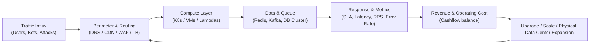
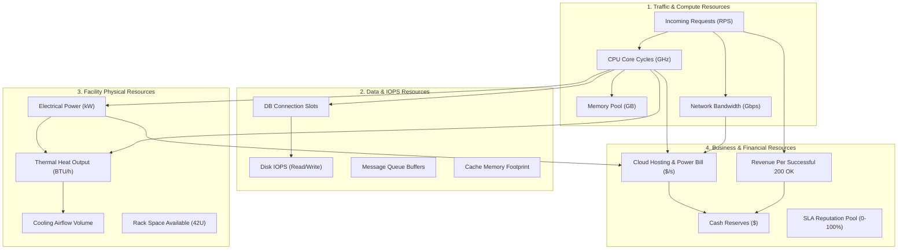
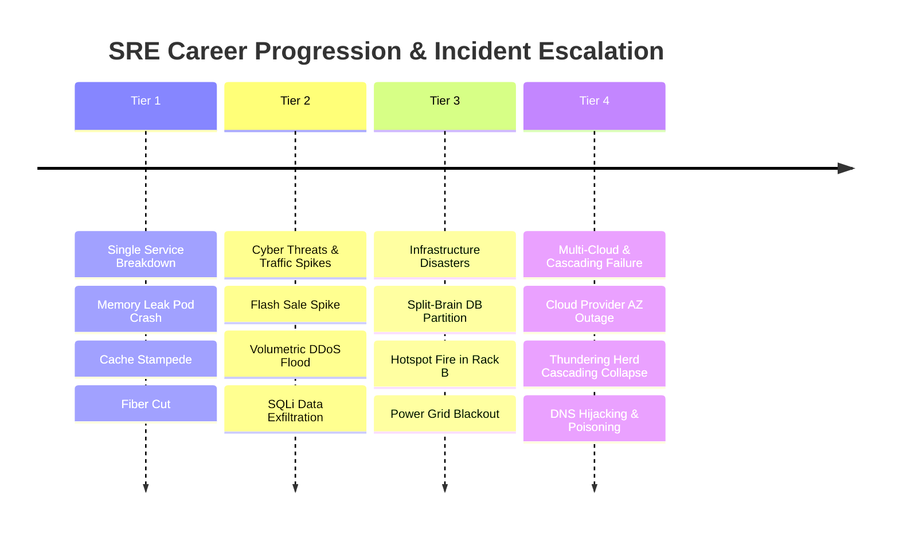
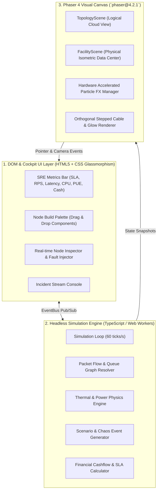

# Research & Game Design Concept: Cloud & Data Center Builder / Simulator (Full Game)

## 1. Executive Summary & Vision

Game ini berkonsep **City Builder / Tower Defense / Infrastructure Management Simulation** dengan tema arsitektur Backend & Cloud Data Center.
Pemain berperan sebagai **Lead Infrastructure / Cloud Solutions Architect & SRE** yang membangun topologi sistem, menghubungkan komponen (WAF, DNS, CDN, Load Balancer, API Gateway, App VMs/Containers, Microservices, Cache, DB, Message Brokers), lalu menghadapi berbagai beban trafik nyata (organic traffic spike, flash sales, stress tests) serta ancaman dan bencana (DDoS, SQLi/RCE, network partition, hardware failure, AZ outage).

### Core Inspiration
1. **Factorio / Mindustry:** Routing data packets, visual queue lines, buffer management, throughput bottleneck.
2. **Server Survival / Datacenter Survival:** Penempatan komponen cloud & routing paket berwarna (HTTP GET, POST, DB Query, Attack packet).
3. **SimCity / Cities: Skylines:** Layout zoning, budget management, power/cooling, capacity planning, reliability metrics.
4. **Mini Metro:** Minimalist flow balancing, dynamic traffic generation, routing optimization under pressure.

---

## 2. Gameplay Mechanics & Core Loops

### 2.1 The Two Perspectives / Dual-View System
Pemain dapat beralih antara 2 layer tampilan (*seamless hotkey switch `Tab`*):
1. **Logical / Topology View (Cloud Architecture Layer):**
   - Model diagram topologi interaktif (mirip Draw.io / AWS Architecture Canvas).
   - Menempatkan node (VPC Subnets, LB, App Pods, Redis, DB) dan menghubungkannya dengan kabel jaringan virtual / network pipes.
   - Paket data bergerak melalui node dengan latency, throughput bandwidth, queue size, dan processing cost.
2. **Physical / Facility View (Data Center Tier Layer):**
   - Isometric grid gedung datacenter (City builder / SimCity aesthetic).
   - Menata Server Racks, PDU (Power Distribution Units), HVAC/CRAC (Computer Room Air Conditioning) units, Fiber Optic Trays, Backup Diesel Generator, UPS battery banks.
   - Mengelola **Power Usage Effectiveness (PUE)**, thermal heat dissipation, CFM airflow (hot-aisle vs cold-aisle containment), dan physical rack unit (RU) density.

---

## 3. Komponen Arsitektur & Building Blocks (Expanded)

### 3.1 Logical Architecture Components

| Kategori | Komponen | Fungsi dalam Game | Kapasitas & Metrik | Dampak Kegagalan / Bottleneck |
| :--- | :--- | :--- | :--- | :--- |
| **Ingress & Perimeter** | **Anycast DNS (Route 53 / Cloudflare)** | Geolocation routing, Latency-based routing, Health checks | Resolve RPS, TTL (30s - 300s) | DNS resolution timeout; propagation delay saat failover |
| | **WAF (Web App Firewall)** | Inspect packet headers, SQLi/XSS signatures, rate-limit | Max 25k RPS, CPU inspection overhead (+4ms latency) | Jika disabled: exploit packet merusak database; jika overloaded: traffic dropped |
| | **CDN (Edge Cache)** | Serve static assets & cacheable edge endpoints | 100k RPS, Cache hit 60-95% | Cache miss storm ke origin backend |
| | **Load Balancer (ALB / NLB)** | Round Robin, Least Connections, IP Hash | Throughput bandwidth (1 Gbps - 40 Gbps), active conn pool | Connection drop jika connection pool habis |
| **Ingress & Compute** | **API Gateway** | JWT Authentication, Request transformation, Rate limiter | Token verification RPS (5,000 RPS) | Auth bottleneck; 429 Too Many Requests |
| | **Stateless Containers (K8s Pods / VMs)** | Menjalankan business logic, compute-heavy tasks | CPU cores (1-8), RAM (2-16GB), Concurrency (50-500 conn) | Out-Of-Memory (OOMKilled), CPU throttling (latency melonjak) |
| | **Serverless Functions (FaaS)** | Auto-scale instan untuk event-driven tasks | Auto-scale up to 5,000 instances | Cold start delay (250ms - 1500ms); biaya per-invokasi mahal pada load kontinu |
| **Message & Streaming** | **Message Broker (Kafka / NATS / RabbitMQ)** | Decouple sync calls, buffer spike load, event mesh | Ingestion MB/s, Partition count, Queue depth | Consumer lag bertumpuk; Disk buffer full -> Drop packet / DLQ |
| **Caching & Acceleration**| **In-Memory Cache (Redis / Memcached)** | Key-value store, session state, query cache | Read/Write IOPS (100k+ IOPS), Memory size | Cache eviction storm, Cache penetration ke database |
| **Storage & Database** | **Relational DB (PostgreSQL / MySQL Master-Replica)**| ACID transactions, multi-table joins, relational data | Max Connections (100-2,000), Write IOPS, Read IOPS | Connection pool starvation, replication lag, table lock congestion |
| | **Distributed NoSQL (Cassandra / DynamoDB / Scylla)** | High-throughput write data, time-series, analytics | Shard count, partition write throughput | Eventual consistency read lag, hotspot partition throttle |
| | **Object Storage (S3 / MinIO / Ceph)** | Unstructured blob files, media, database backups | Bandwidth per second, storage TB | Latency per object fetch; egress bandwidth cost |
| **Security & Platform** | **Secrets Manager & IAM Vault** | Rotate keys, secure inter-service mTLS | Auth verify throughput | Vault timeout memblokir spin-up pod baru |
| | **APM & Prometheus/Grafana** | Observability, incident alerting, auto-remediation triggers | Data retention, scrape interval | Tanpa APM: Latency & error rate tidak terlihat di HUD |

---

### 3.2 Physical Facility Components (Data Center Layer)

| Komponen Fisik | Fungsi dalam Data Center | Konsumsi Daya & Thermal | Konsekuensi & Resiko |
| :--- | :--- | :--- | :--- |
| **Standard 42U Server Rack** | Menampung 42 Unit server blade / compute nodes | 5 kW - 25 kW per rack | Overcrowded rack memicu hotspot panas lokal |
| **PDU (Power Distribution Unit)** | Menyalurkan listrik 3-phase ke server rack | Efisiensi 98%, proteksi surge | PDU breaker trip mematikan seluruh rack seketika |
| **CRAC / In-Row Chiller (HVAC)** | Menyerap panas server, sirkulasi udara dingin | Mengonsumsi listrik besar (+30% PUE) | Chiller breakdown memicu thermal shutdown dalam 60 detik |
| **Containment Doors (Hot/Cold Aisle)** | Memisahkan aliran udara dingin dan panas | Passive infrastructure | Tanpa containment: efisiensi cooling drop 40% |
| **UPS Battery Bank (Flywheel/Lithium)** | Backup daya sementara (15-30 menit) saat PLN padam | Standby loss 2-4% | Baterai drop sebelum generator hidup = Data corruption |
| **Diesel Backup Generator** | Generator darurat kapasitas megawatt | Konsumsi bahan bakar solar per jam | Butuh 10 detik startup spin-up; stok solar bisa habis |
| **Fiber Optic Entrance (Meet-Me-Room)** | Koneksi redundant Tier-1 ISP transit | Bandwidth link 10Gbps - 400Gbps | Fiber cut oleh ekskavator mematikan salah satu ISP provider |

---

## 4. Resource Groups & Resource Flow Engine

Dalam simulasi ini, game engine melacak 4 kelompok resource utama yang saling bertransaksi:

### 4.1 Resource Flow Equations

1. **Request Lifecycle Flow:**
   $$\text{Total Latency} = T_{\text{DNS}} + T_{\text{WAF}} + T_{\text{LB}} + T_{\text{Compute}} + (P_{\text{CacheHit}} \times T_{\text{Cache}} + (1 - P_{\text{CacheHit}}) \times T_{\text{DB}})$$
2. **Thermal Heat Generation:**
   $$\text{Heat}_{\text{Generated}} (\text{BTU}) = \text{Power}_{\text{Consumed}} (\text{Watts}) \times 3.41214 \times (1 + \text{CPU}_{\text{Load}}\%)$$
3. **PUE (Power Usage Effectiveness):**
   $$\text{PUE} = \frac{\text{Total Facility Power (IT + Cooling + Losses)}}{\text{IT Equipment Power}}$$
   *(Target: 1.15 - 1.25. PUE > 1.8 menguras uang pemain untuk tagihan listrik)*
4. **Economic Cashflow:**
   $$\text{Net Income} = (\text{Successful Requests} \times \$0.0002) - (\text{Infrastructure Rental} + \text{Power Bill} + \text{Bandwidth Egress}) - \text{SLA Penalties}$$

---

## 5. Comprehensive Disaster & Chaos Scenarios Catalog

Game menyediakan skenario bencana berjenjang dari level Junior SRE hingga Principal Architect:

### 5.1 Detail Matriks Skenario Insiden

| Skenario Insiden | Trigger & Penyebab | Dampak Visual & Telemetri | Tindakan Mitigasi / Penyelesaian Pemain |
| :--- | :--- | :--- | :--- |
| **1. Memory Leak Pod Crash** | Worker code tidak me-release RAM; memory naik bertahap | Pod berkedip ungu, status OOMKilled, Pod restart berulang, 502 Bad Gateway | Naikkan memory limit, enable Pod Auto-Restart, atau rollback deployment versi lama |
| **2. Flash Sale Traffic Surge** | Campaign marketing / promo viral mendadak | RPS naik dari 150 ke 5,000+ RPS; antrean request merah; Pod CPU 100% | Pasang CDN agresif, nyalakan HPA (Horizontal Pod Autoscaler), aktifkan Queue Throttling |
| **3. Volumetric DDoS Flood** | Botnet menyerang IP Load Balancer langsung | Jutaan partikel merah membanjiri ingress, bandwidth saturasi, ALB unresponsive | Aktifkan Cloudflare Magic Transit / AWS Shield, ganti Public IP, filter GeoIP traffic |
| **4. SQL Injection (Exploit Breach)** | Hacker menyuntikkan query jahat ke endpoint pencarian | Partikel merah tengkorak menembus ke DB, peringatan data breach, reputasi anjlok | Aktifkan WAF Managed SQLi Ruleset, isolasi database connection, roll security patch |
| **5. Cache Stampede (Dogpiling)** | Key cache populer expired bersamaan saat peak load | Cache hit rate drop ke 0%, ribuan thread langsung menembak DB, DB IOPS 100% | Aktifkan Cache Pre-warming, pasang Probabilistic Early Expiration (XFetch), lock mutex |
| **6. Database Split-Brain Partition** | Network link antar Availability Zone terputus | Dua node database mengira dirinya Master, menulis data berbeda, inkonsistensi data | Aktifkan Raft / Paxos consensus quorum, isolasi node minoritas, trigger failover terarah |
| **7. Physical Server Rack Overheating** | AC Chiller kompresor mati, suhu rack naik > 45°C | Server rack di Facility View memerah, asap keluar, thermal throttling CPU turun 80% | Alihkan beban traffic ke Rack sebelah, nyalakan Emergency Exhaust Fan, panggil teknisi HVAC |
| **8. Utility Power Grid Blackout** | PLN / trafo listrik kota meledak | Listrik padam total, UPS battery timer menghitung mundur (15:00... 14:59) | Segera nyalakan Diesel Backup Generator sebelum baterai UPS mencapai 0% |
| **9. Thundering Herd Cascading Failure**| Backend down, client apps retry serentak tanpa jitter | Retry multiplier 5x lipat, setiap kali service bangkit langsung tumbang lagi | Pasang Circuit Breaker (Netflix Hystrix pattern), Exponential Backoff + Jitter di Ingress |
| **10. Cloud Provider AZ Outage** | Data center AWS/GCP di zona ap-southeast-3a banjir | Seluruh subnet Zone A offline total; koneksi terputus | Multi-AZ Cross-Region Failover via Route 53 Health Checks ke Zone B & C |

---

## 6. Arsitektur Teknis Game: Phaser Engine (Latest v4.2.1)

Game diimplementasikan penuh menggunakan engine **Phaser 4** (`phaser@4.2.1`) yang digabungkan dengan decoupled simulation layer:

### 6.1 Detail Implementasi Phaser 4

1. **Dual Scene Architecture:**
   - `TopologyScene`: Menggunakan Phaser 4 2D Camera dengan pan, smooth zoom, dan orthogonal cable routing.
   - `FacilityScene`: Menggunakan Phaser 4 Isometric Projection Matrix (`IsoGrid`) untuk menempatkan server racks, cooling tiles, dan PDU secara 2.5D.
2. **Headless Separation (Verifiable Testing):**
   - Logika simulasi (paket, queue, latency, temperatur, uang) berada di class murni tanpa dependensi Phaser DOM.
   - Memungkinkan unit testing otomatis (`npm test`) tanpa browser canvas.
3. **Phaser 4 Particles & FX:**
   - Memanfaatkan Phaser 4 particle emitter pooling untuk merender hingga 10,000 partikel paket data request per detik secara fluid 60 FPS pada WebGL.
   - Dynamic PostFX pipelines untuk efek glow neon kabel serat optik dan laser WAF shield.

---

## 7. Pipeline Aset Visual via RunComfy (ComfyUI Cloud)

Aset visual dihasilkan dengan konsistensi gaya melalui script otomatisasi menggunakan RunComfy API:

### 7.1 Style Specification & Prompts

| Tipe Aset | Visual Style | Prompt Template RunComfy |
| :--- | :--- | :--- |
| **Server Rack (Idle)** | Isometric Pixel Art 32-bit | `isometric pixel art of a 42U datacenter server rack, dark metallic chassis, glowing cyan status LEDs, clean white background, asset for simulation game --seed 4201` |
| **Server Rack (Overheating/Fire)** | Isometric Pixel Art 32-bit | `isometric pixel art of a 42U server rack emitting smoke and warning orange strobe lights, melting cable trays, clean background --seed 4201` |
| **CRAC / Chiller Unit** | Isometric Pixel Art 32-bit | `isometric pixel art of industrial server room air cooling unit, large fan intake, blue ice tint, industrial pipe, clean background --seed 4202` |
| **Diesel Generator** | Isometric Pixel Art 32-bit | `isometric pixel art of industrial backup diesel power generator, yellow Caterpillar style, exhaust pipe, fuel tank, clean background --seed 4203` |
| **Cloud Topology Icons** | Flat Sci-Fi 2.5D Blueprint | `isometric vector icon of cloud load balancer, glowing blue nodes and network pipes, futuristic tech schematic, clean background --seed 4204` |

---

## 8. Game Modes & Progression

1. **Career Campaign Mode (Story-Driven SRE):**
   - **Level 1: The Startup Launch:** Mulai dengan 1 VM dan 1 Database. Handle organic traffic pertumbuhan user baru.
   - **Level 2: The E-Commerce Flash Sale:** Bangun sistem auto-scaling dan cache untuk menghadapi diskon 11.11.
   - **Level 3: Under Cyber Siege:** Menghadapi kampanye DDoS dan serangan credential stuffing dari kompetitor gelap.
   - **Level 4: Multi-Region Global Expansion:** Ekspansi ke 3 benua dengan latensi < 100ms di seluruh dunia.
   - **Level 5: Tier-4 Data Center Greenfield:** Bangun fisik data center dari tanah kosong: atur genset, trafo, cooling loop, dan redudansi listrik 2N.
2. **Sandbox Mode (Chaos Lab):**
   - Budget tak terbatas. Pemain bebas mendesain arsitektur cloud paling ekstrem dan menembakkan skenario bencana kombinasi (contoh: Gempa bumi + DDoS + DB corruption secara serentak).
3. **Survival / Endless Mode:**
   - Beban trafik bertambah secara eksponensial setiap 2 menit sampai arsitektur pemain kolaps total. Leaderboard waktu bertahan.
