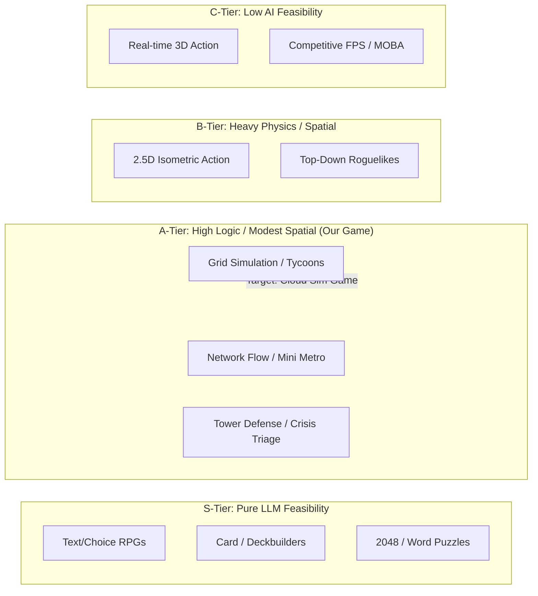
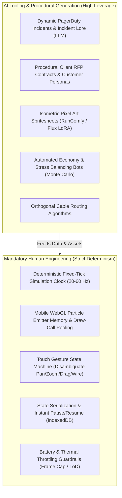
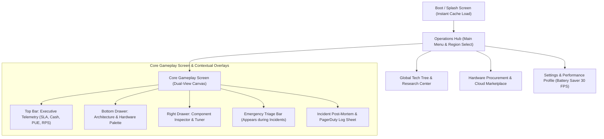
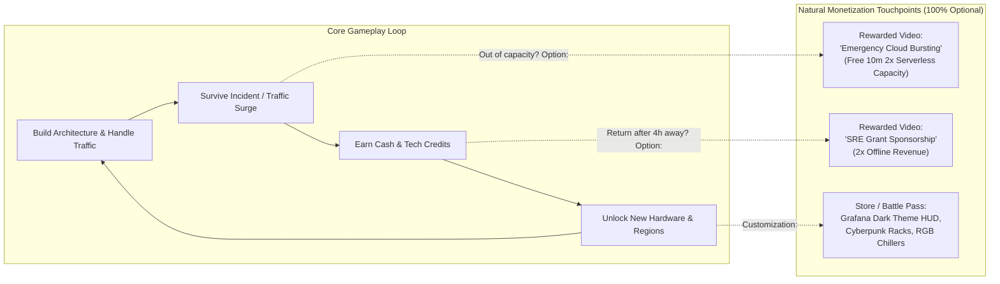
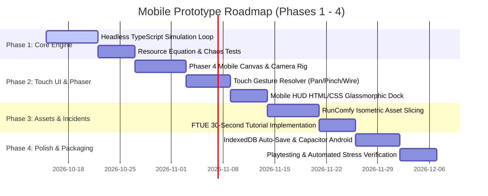

# Mobile Game Feasibility & Deep Research Study: Cloud & Data Center Simulation Game

**Document Version:** 1.0.0  
**Role:** Senior Mobile Game Designer & Technical Producer  
**Date:** 2026-10-14  
**Project:** Cloud & Data Center Simulation Game (`cloud-datacenter-sim-game`)  
**Reference Document:** [`docs/CLOUD_DATACENTER_SIMULATION_GAME_DESIGN.md`](./CLOUD_DATACENTER_SIMULATION_GAME_DESIGN.md)

---

## Executive Overview

This study evaluates the technical, ergonomic, and commercial viability of translating the desktop-oriented **Cloud & Data Center Builder / Simulator** game concept into a high-retention, touchscreen-optimized mobile title. The game bridges two distinct mental models: **Logical Cloud Architecture** (2D node graph routing data packets, reminiscent of *Mini Metro* and *Mindustry*) and **Physical Facility Engineering** (2.5D isometric data center construction, managing PUE, power distribution, and thermal thermodynamics, akin to *SimCity* and *Software Inc.*).

Below is the comprehensive engineering feasibility, UI/UX mobile redesign, competitor benchmarking, and production roadmap.

---

# SECTION 1: AI DEVELOPMENT FEASIBILITY & GENRE CLASSIFICATION

## 1.1 Realistic AI Capability Spectrum & Sub-Genre Mapping

### Sub-Genre Definition
- **Exact Sub-Genre:** **Automation & Network Routing Simulation / Infrastructure Tycoon with Real-Time Incident Triage (Crisis Management)**.
- **Spectrum Classification:** **Medium AI Feasibility with High Logic Automation (A-Tier Feasibility)**.



### Why This Sub-Genre Fits Agentic & AI Development
1. **The Axiom of Agentic Development ("An Agent Can Build What It Can Verify"):**
   - The game's heart is a **discrete, headless mathematical engine** (Traffic RPS, Packet Latency, BTU heat dispersion, PUE calculation, cashflow balance).
   - This entire state machine can be tested headlessly in Node.js / Web Workers without needing a visual canvas or subjective "feel" tuning. Unit tests, chaos fuzzing, and tick simulation assertions can verify 100% of game balance deterministically.
2. **Mitigating the Spatial Layout Bottleneck:**
   - LLMs struggle with freehand continuous coordinate placement (spatial blind spots). 
   - However, our game relies on **discrete graph nodes** and **fixed grid tiles**:
     - *Logical View:* Node-and-edge graph with snap-to-grid or algorithmic auto-layout (Sugiyama hierarchical layout / spring-embedder).
     - *Physical View:* Discrete isometric grid ($N \times M$ floor tiles), where racks and HVAC units occupy integer cell coordinates $(x, y)$.
   - This turns spatial placement into a structured, verifiable discrete constraint satisfaction problem.

---

## 1.2 AI-Driven Systems Architecture vs. Mandatory Human Engineering

Modern generative AI tooling (LLMs, Diffusion image models, ComfyUI/RunComfy pipelines, and automated balancing agents) can accelerate ~65% of the development cycle, but strict boundaries exist where human engineering is indispensable:



### AI Technical Feasibility Matrix

| Game System | Target Implementation | AI Tooling / LLM Role | Human Engineering Role | Feasibility Score |
| :--- | :--- | :--- | :--- | :--- |
| **Headless Simulation Loop** | Fixed-timestep tick runner, resource flow equations | 90% Code Generation (pure TypeScript math classes for PUE, Latency, IOPS, Cash) | Architecture design, tick determinism, floating-point roundoff protection | **9.5 / 10** |
| **Incident & Chaos Engine** | 10+ disaster scenarios, random trigger thresholds | 85% Code & Content (LLM generating incident parameters, error logs, flavor text) | State rollback logic, recovery state verification, event dispatching | **9.0 / 10** |
| **Visual Art & Assets** | 2.5D Isometric racks, CRACs, generators, 2D icons | 80% AI Generated (RunComfy ComfyUI API, isometric LoRAs, automated SVG icon creation) | Sprite sheet slicing, pivot alignment, normal map baking, transparent padding trim | **8.5 / 10** |
| **Procedural Level / Contracts**| Progressive career missions, client requirements | 85% LLM / Procedural (RFP generator with dynamic SLA/RPS requirements) | Difficulty curves, progression gates, contract validation rules | **9.0 / 10** |
| **Auto-Balancing & QA** | Stress testing economy, PUE runaways, bottlenecks | 80% Automated (Headless bot running 100,000 ticks at 1,000x speed to find deadlocks) | Setting heuristics, defining fitness functions, tuning reward/penalty ratios | **8.5 / 10** |
| **Touch Input & Gestures** | Multi-touch gesture resolver (pan, pinch, drag-wire) | 40% LLM (Boilerplate event listeners) | Complex touch disambiguation, gesture conflict resolution, hit testing | **5.0 / 10** |
| **Mobile WebGL Rendering** | Phaser 4 / PixiJS canvas, 5,000+ data packet particles | 50% LLM (Scene lifecycle, pipeline config) | Particle pooling, shader optimization, draw call batching, memory leak prevention | **5.5 / 10** |
| **Save/Resume & State Cache** | Instant resume, offline progression calculation | 60% LLM (Serialization schemas) | IndexedDB transactions, offline timestamp delta math, schema migrations | **7.0 / 10** |

---

# SECTION 2: MOBILE UI/UX ARCHITECTURE & DESIGN

## 2.1 Touchscreen Ergonomics & Form Factor

### Landscape vs. Portrait Analysis

| Dimension | Portrait (9:16 / 9:20) | Landscape (16:9 / 20:9) — **RECOMMENDED** |
| :--- | :--- | :--- |
| **Architectural Topology Fit** | Poor. Cloud architectures expand horizontally (Ingress $\rightarrow$ Compute $\rightarrow$ Data). Requires deep vertical scrolling. | **Optimal.** Natural left-to-right flow matches standard system architecture diagrams (AWS/GCP/Azure). |
| **Isometric Facility View Fit**| Mediocre. Limits the width of server rooms; restricts hot/cold aisle visibility. | **Optimal.** Wide perspective accommodates multi-row server halls and cooling loops cleanly. |
| **Thumb Ergonomics** | Single-handed thumb play is comfortable, but screen is cramped with telemetries. | **Two-thumb split zone:** Left thumb controls navigation and camera; right thumb controls build actions and triage. |
| **Information Density** | High risk of HUD clutter obscuring the game field. | Allows dedicated HUD flanks (left telemetry dock, right action dock) leaving center clean. |

**Verdict:** **Landscape Orientation (Locked)**. Landscape provides the necessary canvas width for readable node graphs while allowing a dedicated, non-intrusive dual-thumb control scheme.

### Ergonomic Thumb Zone Heat Map (Landscape Mobile)

```
+---------------------------------------------------------------------------------------+
| [Notch Safe]  Top Metrics Bar: Cash | Net/s | SLA% | PUE | RPS | Errors  [Speed: 1x 2x] |
+---------------------------------------------------------------------------------------+
|  STRETCH ZONE               UNREACHABLE / NEUTRAL ZONE                   STRETCH ZONE |
|  (Secondary Info)           (Core Visual Canvas: Racks & Nodes)         (Settings/Log)|
|                                                                                       |
|  [View Switch:              +---------------------------------+          [Triage FAB: |
|   Topo / Facility]          |                                 |           Active      |
|                             |      Interactive Game View      |           Alerts (3)] |
|  COMFORT ZONE               |       (Pan / Pinch / Tap)       |          COMFORT ZONE |
|  (Left Thumb: Camera        |                                 |          (Right Thumb:|
|   Recenter, Minimap,        +---------------------------------+           Build Drawer|
|   Filter Layers)                                                          & Inspector)|
+---------------------------------------------------------------------------------------+
| [Safe Inset]     Bottom Dock: Ingress | Compute | Data | Facility | Upgrades  [Safe Inset]|
+---------------------------------------------------------------------------------------+
```

### Touch Target Standards & Safe Areas
1. **Minimum Touch Target:** Strict minimum of **48 $\times$ 48 dp** (with minimum 8 dp spacing between interactive buttons) to prevent mis-clicks during high-stress chaos events.
2. **Safe Area Insets:** All UI components respect `env(safe-area-inset-*)`:
   - Left / Right margins: Minimum 16 dp padding away from curved edges and screen corners.
   - Top margin: 32 dp buffer clearing camera punch-holes and notches.
   - Bottom margin: 24 dp buffer preventing accidental triggers of the Android/iOS Home navigation swipe bar.
3. **Mobile-Native Interaction Patterns:**
   - **Tap:** Select node/rack $\rightarrow$ opens Contextual Quick-Action Sheet.
   - **Hold & Drag (from Build Dock):** Spawns component with visual ghost footprint; snaps to valid grid positions.
   - **Point-to-Point Drag (Wiring Mode):** Touch output port of Node A $\rightarrow$ drag neon line to Node B $\rightarrow$ haptic click on valid snap (invalid nodes show red semi-transparent rejection).
   - **Pinch-to-Zoom & Two-Finger Pan:** Continuous camera scaling ($0.5\times$ to $2.5\times$) with smooth momentum damping.
   - **Double Tap:** Immediately focus camera on the highest-severity incident alert.

---

## 2.2 Screen Hierarchy & Information Architecture



### Contextual HUD Design & Anti-Clutter Rules
1. **Collapsible Build Palette:** The component drawer stays collapsed at the bottom ($44\text{ dp}$ header) displaying category icons. Swiping up reveals the full component tray; tapping the canvas auto-retracts it.
2. **Contextual Inspector:** Selecting any component (e.g., *ALB*, *Redis Cache*, *CRAC Unit*) slides in a compact half-screen bottom-right sheet with essential dials (Capacity, CPU load %, Memory %, Throttling switch, Reboot/Rollback button). Tapping outside dismisses it.
3. **Sensory Feedback Loop:**
   - **Haptic Feedback:**
     - *Light Impact (10ms):* Successful cable snap, grid placement.
     - *Double Buzz (30ms):* Incident spawned (e.g., Pod OOMKilled).
     - *Heavy Pulse (80ms):* Power breaker tripped, SLA critical warning ($< 90\%$).
   - **Visual Feedback:** Screen perimeter pulses with soft amber vignette when SLA drops below $95\%$, and pulsing red vignette when below $90\%$.
   - **Audio Design:** Satisfying mechanical click for rack placement, high-tech neon hum for fiber connections, and realistic server fan acceleration sounds as CPU load increases.

### Onboarding: The 30-Second FTUE ("The Day 1 Black Friday Outage")
Mobile players bounce if forced through multi-page textual tutorials. The FTUE drops players directly into action:
- **0:00 - 0:05:** Screen boots into a warning state: A single Monolith App Pod is pulsing red with smoke; incoming requests ($500\text{ RPS}$) are dropping ($502\text{ Bad Gateway}$). Audio siren plays.
- **0:05 - 0:12:** Pulsing finger pointer highlights the Monolith pod: *"Database query bottleneck! Add an In-Memory Cache!"*
- **0:12 - 0:20:** Finger drags a **Redis Cache** icon from the drawer to the canvas; animated line indicates dragging cable from Monolith to Redis.
- **0:20 - 0:25:** Cache connects! Latency drops from $1,200\text{ ms}$ to $8\text{ ms}$. Error particles turn neon green ($200\text{ OK}$). Floating cash numbers appear ($+\$500$).
- **0:25 - 0:30:** Banner pops: *"Incident Mitigated! You saved the flash sale. Company Level Up!"* Player is instantly invested.

### Micro-Session Optimization & Instant Resume
- **Cold Boot Target:** $< 1.8\text{ seconds}$ to active gameplay.
- **Auto-Save Engine:** Game state serializes to `IndexedDB` every $5\text{ seconds}$ and immediately upon `document.visibilitychange` / app backgrounding.
- **Offline Catch-Up Calculation:** Upon resume, a headless catch-up equation simulates elapsed time (up to 8 hours), awarding earned revenue and logging simulated background telemetry without draining battery while closed.

---

# SECTION 3: MARKET FIT & MONETIZATION

## 3.1 Competitor Landscape Analysis

```mermaid
quadrantChart
    title Mobile Simulation & Logistics Competitor Landscape
    x-axis Low Technical Depth --> High Technical Depth
    y-axis Casual / Hyper-Casual --> Core / Hardcore Simulation
    quadrant-1 Deep Technical Simulation (Our Target)
    quadrant-2 Niche / Complex PC Ports
    quadrant-3 Casual Tycoons
    quadrant-4 Accessible Flow Games
    "Idle Miner Tycoon": [0.20, 0.25]
    "SimCity BuildIt": [0.45, 0.40]
    "Mini Motorways": [0.35, 0.65]
    "Builderment": [0.65, 0.60]
    "Mindustry": [0.85, 0.85]
    "Cloud Datacenter Sim (Our Game)": [0.80, 0.75]
```

### Competitor Comparison Table

| Game | Platform & Sub-Genre | UI / UX Strengths | Monetization Strategy | Typical Session Length | Core Takeaway for Cloud Sim |
| :--- | :--- | :--- | :--- | :--- | :--- |
| **Mindustry** *(Anuken)* | Mobile/PC open-source logistics & factory tower defense | High density, pinch-zoom across vast maps, customizable contextual build radial | 100% Free / FOSS on Android ($2.99 on iOS). Zero ads or predatory mechanics. | **20 – 45 mins** (Deep sessions) | Proof that complex routing, resource pipelines, and defense mechanics have millions of mobile fans if controls are responsive. |
| **Mini Motorways** *(Dinosaur Polo Club)* | Apple Arcade / PC dynamic traffic flow management | Masterclass in minimalist, clutter-free HUD; intuitive touch drawing; spatial audio feedback | Subscription (Apple Arcade) / Premium. | **6 – 12 mins** (Bite-sized intense runs) | Minimalist vector aesthetics and audio feedback make network congestion management addictive rather than stressful. |
| **Builderment** *(Builderment LLC)* | Mobile factory building & conveyor automation | Touch-first factory layout, smooth dragging, clear tier progression | Free-to-play with non-intrusive rewarded ads and cosmetic/blueprint IAP. | **10 – 20 mins** | Shows that modern mobile gamers embrace factory/automation loops when simplified for finger controls. |

---

## 3.2 Non-Intrusive Monetization UI Architecture

To preserve high retention among an intellectually discerning demographic (engineers, tech enthusiasts, simulation fans), monetization must never feel predatory or break immersion.



### Monetization Implementation Details
1. **Rewarded Video Ads (High Value, Zero Penalty):**
   - **Emergency CDN / Cloud Burst:** When traffic exceeds current rack capacity by $> 30\%$, player can watch an ad to trigger *"AWS Cloud Burst Sponsorship"* (temporarily routing overflow traffic to an external cloud for 5 minutes with zero SLA penalty).
   - **Offline Standby Grant:** Upon returning to the game, player collects normal offline revenue; watching a 30s ad doubles the offline yield.
   - **Rule:** **Zero forced interstitial ads**. Ads exist strictly as player-initiated utility boosts.
2. **Quarterly SRE Season Pass ("Compliance & Architecture Pass"):**
   - Free track: Standard hardware blueprints and cash grants.
   - Premium track ($4.99): Exclusive datacenter cosmetics (Liquid Nitrogen cooling loops, Glassmorphic Neo-Terminal HUD, retro 1980s mainframe aesthetics, and custom alert ringtones).
3. **One-Time Premium QoL ("DevOps Automation Suite" — $7.99):**
   - Permanent unlock: Automated incident auto-remediation (AI SRE bot restarts failed pods automatically), $2\times$ fast-forward speed, and cloud-synced blueprint sharing.

---

# SECTION 4: DELIVERABLES SUMMARY & NEXT STEPS

## 4.1 Sub-Genre Mechanics Breakdown

```
+---------------------------------------------------------------------------------------+
|                                GAME MECHANIC STACK                                    |
+---------------------------------------------------------------------------------------+
| 1. INGRESS & ROUTING    : DNS Geolocation, CDN Caching, WAF Packet Inspection, ALB    |
| 2. COMPUTE PROCESSING   : Stateless Containers, K8s Auto-scaling, FaaS Cold Starts    |
| 3. ASYNC & STORAGE      : Kafka Queue Buffering, Redis In-Memory Cache, SQL/NoSQL DB  |
| 4. THERMODYNAMICS & PUE : Server Rack Heat (BTU), CRAC Cooling CFM, PUE Multipliers   |
| 5. POWER & RESILIENCE   : PDU Breaker Limits, UPS Battery Drain, Diesel Genset Spin-up|
| 6. CRISIS TRIAGE        : DDoS Mitigation, Cache Stampede Locking, Multi-AZ Failover  |
+---------------------------------------------------------------------------------------+
```

---

## 4.2 Actionable Next Steps for Prototype Development



### Immediate Prioritized Sprints
1. **Sprint 1: Headless Simulation Core & Unit Verification**
   - Extract game formulas (RPS, Latency, BTU, PUE, Cashflow) into standalone TypeScript classes (`src/core/sim/`).
   - Implement unit test suite verifying deterministic calculations under 10,000 synthetic ticks.
2. **Sprint 2: Mobile Touchscreen Input & Dual-Scene Skeleton**
   - Set up Phaser 4 mobile viewport scaling (`Phaser.Scale.FIT`, Landscape lock).
   - Implement touch-gesture state machine: single-touch pan, pinch-zoom, and drag-and-drop component placement.
   - Build responsive HTML5/CSS glassmorphic telemetry bar and bottom build drawer with safe-area padding.
3. **Sprint 3: RunComfy Asset Pipeline & First Playable Incident**
   - Generate isometric 2.5D server racks, CRAC units, and generators via RunComfy ComfyUI API templates.
   - Implement "Scenario 1: Memory Leak Pod Crash" and "Scenario 2: Flash Sale Spike" with touch-to-mitigate controls.
4. **Sprint 4: Mobile Packaging & Offline Persistence**
   - Integrate `IndexedDB` for state snapshots on app pause.
   - Test APK build using Capacitor (`npx cap add android`) to benchmark 60 FPS mobile WebGL performance.
