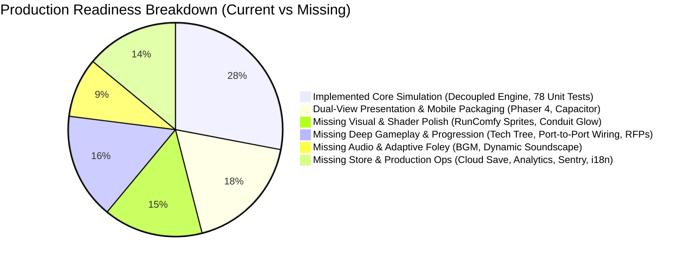
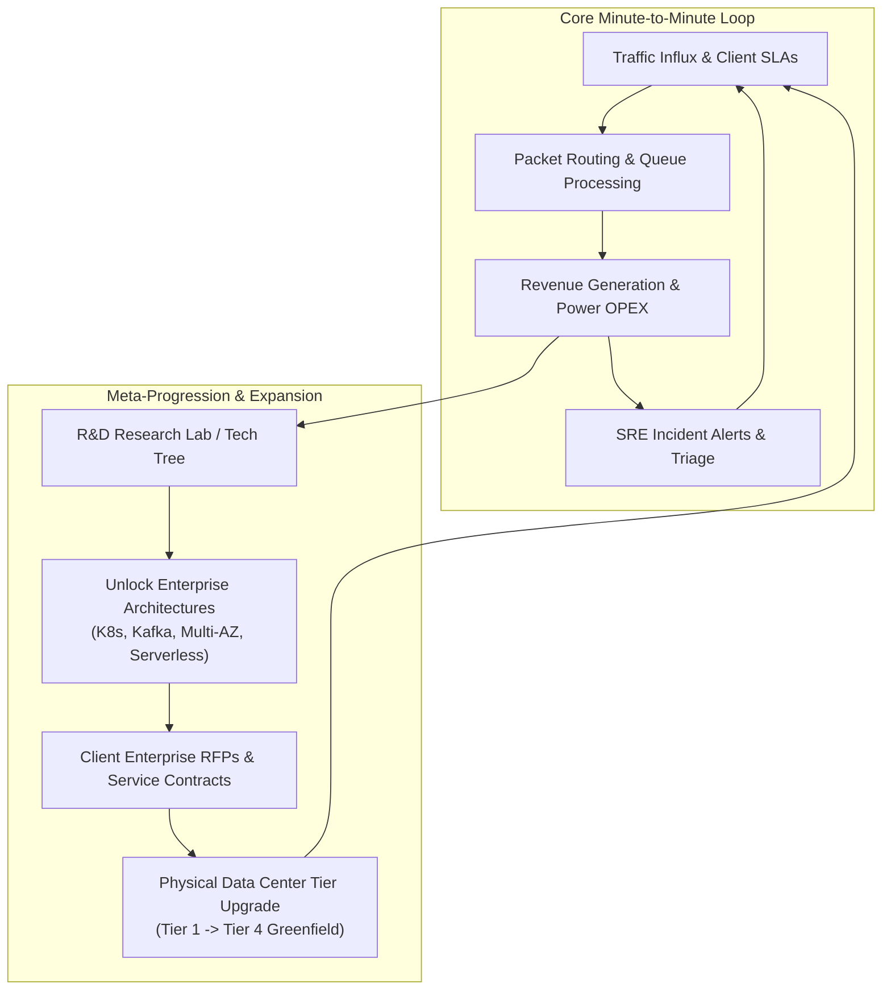
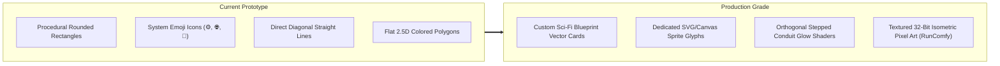
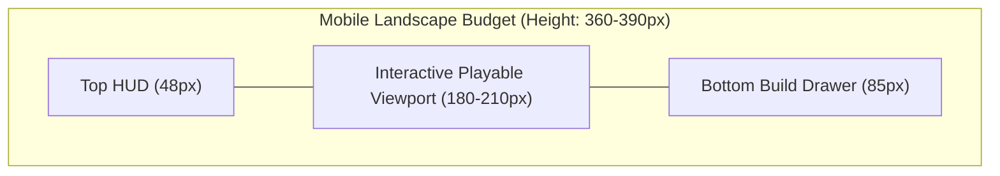
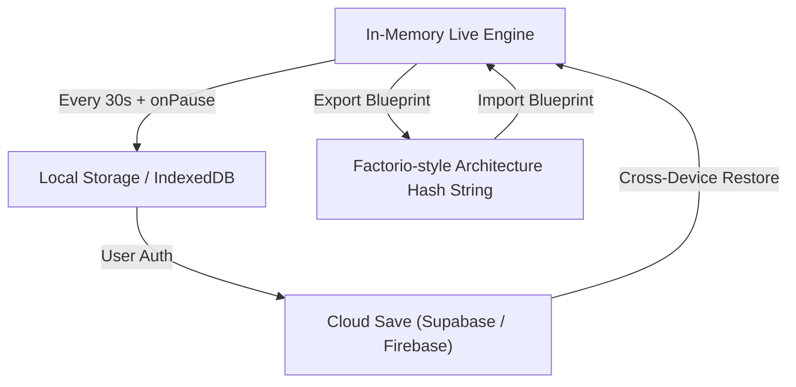
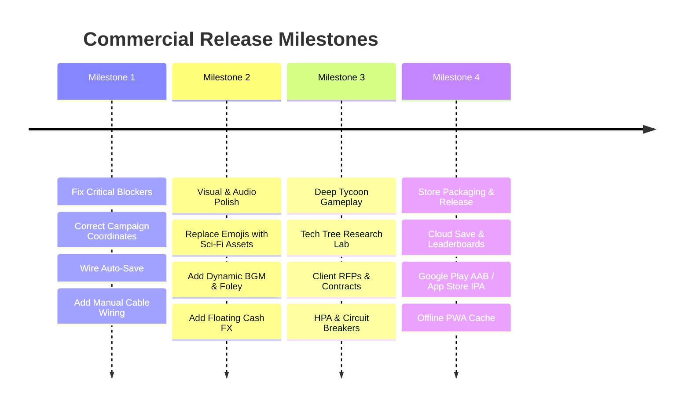

# Deep Research & Production-Grade Gap Analysis: Cloud & Data Center Simulation Game

**Document Version:** 2.0.0  
**Project:** Cloud & Data Center Simulation Game (`cloud-datacenter-sim-game`)  
**Scope:** Commercial & Production Readiness Audit (Web, iOS, Android, Desktop)  
**Target Benchmark:** *Factorio*, *Mindustry*, *Mini Metro*, *Software Inc.*, *Game Dev Tycoon*  
**Date:** 2026-10-15  

---

## Executive Summary

The **Cloud & Data Center Simulation Game** has established an exceptional, rock-solid architectural foundation: a decoupled 60 Hz deterministic headless simulation core, dual-perspective Phaser 4 rendering (2D Logical Topology and 2.5D Isometric Facility), procedural Web Audio synthesis, Capacitor mobile lifecycle/haptics, and containerized Coolify deployment.

However, moving from an **advanced technical prototype / proof-of-concept** to a **production-grade, commercially viable game** (App Store, Google Play, Steam/itch.io, Web) requires closing distinct gaps across **9 major production dimensions**. 

This research paper provides an exhaustive gap analysis, categorizes missing elements by priority (**P0 Critical Blockers**, **P1 Core Experience**, **P2 Market Polish**), and outlines a concrete phased roadmap.

---

## 1. Critical Discrepancies & Immediate Blockers (P0)

Before expanding features, several structural discrepancies in the current implementation must be rectified:

### 1.1 Off-Screen Coordinate Bug in Career Campaign (`CampaignLevels.js`)
- **Diagnosis**: In [`src/core/sim/CampaignLevels.js`](file:///home/arie/labs/cloud-datacenter-sim-game/src/core/sim/CampaignLevels.js#L18-L23), starter nodes for Levels 1–5 are defined with raw pixel coordinates (e.g., `gridX: 100, gridY: 200` and `gridX: 300, gridY: 200`).
- **Impact**: In [`TopologyScene.js`](file:///home/arie/labs/cloud-datacenter-sim-game/src/scenes/TopologyScene.js#L216-L218), node screen positions are calculated as `node.gridX * TILE_PX` (where `TILE_PX = 80`). Multiplying $100 \times 80 = 8,000\text{px}$ places starter nodes thousands of pixels off-screen in empty outer space. Players loading Campaign Levels see an empty void.
- **Required Fix**: Standardize `CampaignLevels.js` to small integer grid cells matching starter layout in [`main.js`](file:///home/arie/labs/cloud-datacenter-sim-game/src/main.js#L40-L45) (e.g., Ingress `(2, 4)`, Gateway `(5, 4)`, Pod `(8, 3)`, DB `(11, 4)`).

### 1.2 Disconnected State Persistence (`StatePersistence.js`)
- **Diagnosis**: [`src/storage/StatePersistence.js`](file:///home/arie/labs/cloud-datacenter-sim-game/src/storage/StatePersistence.js) implements save-state schema validation, serialization, and 8-hour offline catch-up, but is **never imported or invoked** in [`src/main.js`](file:///home/arie/labs/cloud-datacenter-sim-game/src/main.js).
- **Impact**: Refreshing the browser or reopening the mobile app always resets the game to the hardcoded sandbox starter nodes. Player progression, custom topologies, and accumulated capital are wiped on every session start.
- **Required Fix**: Wire auto-save every 30 seconds, save on `visibilitychange`/pause, and restore saved state on initial boot.

### 1.3 Missing Manual Cable Wiring (Port-to-Port Creation)
- **Diagnosis**: While auto-connect and cable inspection/disconnection were implemented, players cannot manually drag a cable from an output port of Node A to an input port of Node B.
- **Impact**: Players cannot design multi-path topologies, active-passive failover routes, or dedicated read-replica connections. Auto-connect heuristics take away the primary tactile joy of network routing games (*Mini Metro*, *Factorio*).

---

## 2. Gameplay Loop, Progression & Meta-Game (P1)

Commercial tycoons thrive on long-term goals, meaningful constraints, and player agency.

### 2.1 Research Lab & SRE Tech Tree
Currently, all 13 logical components and 6 facility components are immediately available in the Build Drawer from second 0. A production game requires a structured **Tech Tree**:
- **Tier 1 (The Bare Metal Era)**: Single VPS, Monolithic MySQL, Local Disk Storage, DNS.
- **Tier 2 (The Distributed Scale-Out Era)**: Nginx Load Balancers, Redis Caching, Master-Replica SQL, PDU Power distribution.
- **Tier 3 (Cloud-Native & Edge Era)**: Anycast CDN PoPs, WAF Managed Rulesets, Kafka Event Mesh, Horizontal Pod Autoscaling (HPA), CRAC Cold-Aisle Containment.
- **Tier 4 (Hyperscale SRE Era)**: Multi-Region Active-Active failover, Cassandra Distributed NoSQL, Serverless FaaS, Circuit Breakers (Hystrix), Flywheel UPS & Megawatt Diesel Gensets.

### 2.2 Client Enterprise RFPs & Dynamic Service Contracts
Instead of passive arbitrary traffic, players should bid on and manage real **Customer Personas**:
- **Fintech Bank ("NeoVault")**: High write throughput, zero tolerance for packet drops ($0.05\%$ drop = instant cancellation), requires WAF + PCI-DSS compliance + multi-AZ replication.
- **Video Streaming Service ("StreamFlix")**: Massive read bandwidth, 90% CDN edge caching required, spike bursts during evening hours.
- **AI Startup ("ModelScale")**: Heavy GPU compute loads, extreme thermal dissipation, needs high-density cooling containment.

### 2.3 Interactive APM Telemetry & Root-Cause Diagnosis
Currently, incidents are solved via a single button on the Incident Bar. A production game makes incident triage an engaging forensic puzzle:
- **Interactive Grafana/Prometheus Dashboard**: Players inspect P95/P99 latency histograms, 4xx/5xx error distributions, and per-node CPU/Queue graphs.
- **Actionable Remediation**: Rather than clicking "Remediate", the player must locate the choked node, add read-replicas, flush the cache, or patch the WAF rule.

---

## 3. Visual Polish, Shaders & Graphical Fidelity (P1)

### 3.1 Banning System Emojis in Favor of Unified Art Assets
- **The Problem**: Emojis (`⚙️`, `🌐`, `🗄️`, `📦`) render completely differently across iOS, Android, macOS, and Linux, giving the impression of an unfinished hackathon project.
- **The Solution**: 
  - In **Topology View**: High-contrast, glowing cyberpunk/sci-fi vector blueprint cards with animated queue bars and custom SVG component iconography.
  - In **Facility View**: 32-bit isometric pixel-art spritesheets generated via RunComfy ComfyUI LoRAs (Server racks with LED activity lights, industrial CRAC chillers with spinning fans, Caterpillar-style diesel generators, and lithium battery cabinets).

### 3.2 Orthogonal Manhattan Conduit Shaders & Flow Pulses
- Connect nodes using orthogonal stepped conduits (`CableRenderer.getOrthogonalWaypoints`) rather than straight diagonals.
- Add hardware-accelerated neon pulse shaders with glow Bloom (Phaser PostFX) indicating packet flow rate and direction.
- Visually indicate line saturation: cable turns amber when approaching 80% bandwidth and pulses red with sparks when dropping packets.

### 3.3 Visual "Juice" & Micro-Interactions
- **Floating Financial Feedback**: Rising floating indicators (`+$0.002` in emerald green on successful requests; `-$0.015/s` in slate grey on OPEX ticks; `-$500 SLA Penalty!` in flashing red).
- **Incident Visual Atmosphere**: Flashing amber warning beacons on affected racks; thermal heat distortion waves rising from overheated racks; smoke and electrical sparks on hardware failures.

---

## 4. Audio Architecture & Dynamic Soundscapes (P1)

| Sound Layer | Current Prototype | Production Standard |
| :--- | :--- | :--- |
| **BGM (Music)** | *None (Silent)* | **Multi-Stem Dynamic Soundtrack**: Ambient lo-fi synthwave while planning; high-tempo synth bass layers added dynamically when traffic surges or incidents strike. |
| **Datacenter Ambience**| Monophonic 200 Hz lowpass white noise | **Spatial Binaural Facility Soundscape**: Layered 60 Hz electrical transformer hum, high-velocity cooling fans, periodic hard drive array chatter, server blade insertion clicks. |
| **Tactile SFX** | Synthetic sine/square wave beeps | **High-Fidelity Mechanical Foley**: Mechanical keyboard clicks on placement, copper cable snap on connection, heavy industrial switch throw for diesel generator, alarm klaxon for Tier 3/4 crises. |
| **Mixing & Channels** | Master Gain Node only | **4-Bus Web Audio Mixer**: Independent volume sliders for Master, Music, SFX, and Ambience with auto-ducking during emergency sirens. |

---

## 5. Mobile UI/UX & Ergonomic Constraints (P1)

### 5.1 Vertical Screen Clutter on Mobile
- In landscape on mobile devices (e.g., iPhone 15 at 852×393 viewport points), screen height is extremely constrained.
- If the Top HUD (50px), Incident Bar (40px), and Build Drawer (85px) are all expanded, only ~200px remains for the interactive canvas.
- **Production Solution**:
  - Auto-hide Build Drawer during incident triage.
  - Floating radial context menu when tapping any node (Restart, Scale, Upgrade, Delete, Inspect) instead of full-height bottom sheets.
  - Full support for `env(safe-area-inset-left)` and `env(safe-area-inset-right)` to prevent notches and camera cutouts from obscuring edge buttons.

### 5.2 Accessibility & Internationalization (i18n)
- **Colorblind Palettes**: Replace red/green reliance with distinct shape-based indicators (checkmarks for 200 OK, crosses for 500 drops, warning triangles for throttling).
- **Localization Engine**: Abstract all strings from JavaScript templates into JSON locale bundles (`en-US`, `id-ID`, `ja-JP`, `de-DE`, `zh-CN`).

---

## 6. Simulation Realism & SRE Architecture (P2)

To authentically engage DevOps engineers, cloud architects, and tycoon enthusiasts:

1. **Realistic Traffic Profiles & Workload Types**:
   - **Static Content**: Handled at CDN edge ($0$ compute pod overhead, $95\%$ cache hit rate).
   - **Database Reads**: Cache-miss queries routed to Read-Replicas.
   - **Database Writes**: ACID transactions requiring row-level locks on primary database.
   - **Asynchronous Jobs**: Enqueued to Kafka/RabbitMQ and processed by worker pools.
   - **Cyber Threats**: DDoS floods, SQL injection attacks, credential stuffing, and slowloris connection exhaustions.
2. **SRE Architectural Resilience Patterns**:
   - **Horizontal Pod Autoscaler (HPA)**: Configure automated scale-out triggers based on CPU% or queue depth.
   - **Circuit Breakers**: Configurable trip thresholds to prevent cascading database collapse (*thundering herd*).
   - **Multi-AZ Availability**: Distribute pods across Zone A, B, and C with latency penalties during cross-zone synchronization.

---

## 7. Data Persistence, Cloud Save & Blueprint Sharing (P2)

1. **Multi-Slot Save System**: Support multiple save slots (Career Saves, Sandbox Blueprints, Survival Run Archives).
2. **Architecture Blueprint String Exchange**: Allow players to export their cloud architectures as compressed Base64 strings (like *Factorio* blueprint strings) to share on Reddit, Discord, or GitHub.
3. **Cloud Save & Sync**: Synchronize career progress and high scores across web browser and mobile device via Apple Game Center, Google Play Games, or lightweight cloud authentication.

---

## 8. Performance Optimization & Engine Architecture (P2)

1. **Web Worker Offloading (Headless Simulation Isolation)**:
   - Move the 60 Hz physics and traffic routing loop into a dedicated background `WebWorker`.
   - The main browser thread only handles Phaser 4 rendering and DOM events, guaranteeing locked 60/120 FPS without UI jank even during 10,000-packet stress events.
2. **Texture Atlasing & Draw Call Batching**:
   - Consolidate individual SVG/PNG assets into a single texture atlas to reduce WebGL draw calls to $< 10$ per frame.
3. **Battery & Thermal Throttling Guardrails**:
   - Dynamic Level-of-Detail (LoD): When mobile battery is low or device is warm, reduce particle density and drop background grid anti-aliasing.

---

## 9. Platform Compliance & App Store Publishing Roadmap (P2)

To publish on Google Play Store, Apple App Store, and Steam:

### Detailed Release Checklist:
- [ ] **Android Google Play**: Signed Android App Bundle (AAB), target SDK 34+, Privacy Policy URL, Google Play Billing (if IAP), Google Play Games Services Leaderboards.
- [ ] **Apple App Store**: Xcode build with provisioned signing certificates, Apple Game Center integration, App Store review compliance (App Tracking Transparency, Account Deletion).
- [ ] **Offline PWA / Web**: Register Service Worker caching all static assets and audio for 100% offline flight mode gameplay.

---

## Prioritized Implementation Action Plan

| Rank | Task Description | Target File(s) | Impact / Value |
| :--- | :--- | :--- | :--- |
| **1 (P0)** | **Fix CampaignLevels grid coordinates** (change $100, 200$ to integer grid cells $2..12$). | `src/core/sim/CampaignLevels.js` | Restores visibility of Levels 1–5; eliminates off-screen spawn bug. |
| **2 (P0)** | **Wire StatePersistence into game bootstrap** (auto-save every 30s and restore on boot). | `src/main.js`, `src/storage/StatePersistence.js` | Prevents loss of player progress and topologies across sessions. |
| **3 (P0)** | **Implement Manual Port-to-Port Cable Wiring Tool** (drag from node source port to target port). | `src/scenes/TopologyScene.js`, `src/ui/MobileTouchFSM.js` | Restores essential core tactile mechanic of network routing games. |
| **4 (P1)** | **Replace Emojis with Vector Sci-Fi Component Glyphs** (consistent cross-platform visual style). | `src/scenes/TopologyScene.js`, `src/style.css`, `src/ui/NodeInspector.js` | Elevates visual appearance from amateur prototype to professional game. |
| **5 (P1)** | **Implement Multi-Stem Dynamic Audio Engine & BGM** (calm ambient BGM + crisis tempo layers). | `src/core/audio/AudioManager.js` | Transforms game atmosphere; delivers intense emotional feedback during incidents. |
| **6 (P1)** | **Implement Floating Finance & Metric Juice FX** (`+$0.002` revenue, `-$0.015/s` OPEX, SLA alerts). | `src/scenes/TopologyScene.js`, `src/render/ParticlePool.js` | Provides immediate dopamine feedback for successful system scaling. |
| **7 (P2)** | **Implement SRE Tech Tree / Research Lab** (progressive unlocks from Monolith to Kubernetes/Kafka). | `src/core/sim/TechTree.js`, `src/ui/modals/TechTreeModal.js` | Creates long-term motivation, strategic depth, and progression meta. |
| **8 (P2)** | **Implement Client Enterprise RFPs & Service Contracts** (dynamic customer SLAs and penalties). | `src/core/sim/ContractManager.js`, `src/ui/modals/ContractModal.js` | Grounds architecture in realistic business constraints and reward cycles. |
| **9 (P2)** | **Decouple Headless Engine to Web Worker** (separate 60Hz physics clock from Phaser render thread). | `src/core/sim/SimWorker.js`, `src/main.js` | Guarantees silky smooth 60/120 FPS on all mobile devices under heavy load. |
