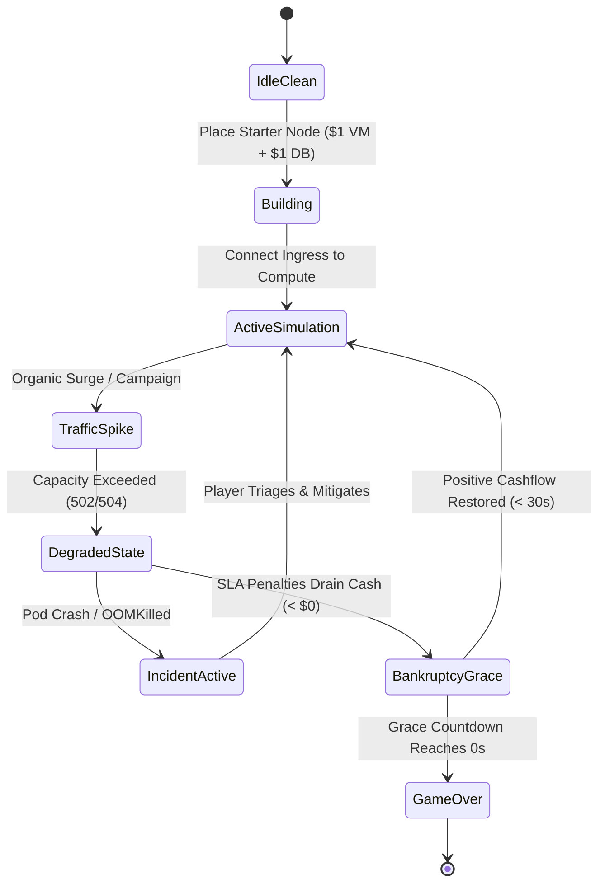

# Data Model & Domain Architecture: Core Simulation Engine & Mobile Cockpit

**Feature**: `001-core-sim-mobile`  
**Date**: 2026-10-14  
**Status**: Completed  
**Spec Reference**: [specs/001-core-sim-mobile/spec.md](./spec.md)  
**Research Reference**: [specs/001-core-sim-mobile/research.md](./research.md)

---

## 1. Domain Entities & Schemas

### 1.1 Infrastructure Node (Logical Cloud Layer)
Represents a software or virtual service in the 2D cloud topology view.

```typescript
export type NodeType =
  | 'CLIENT_INGRESS'  // Organic user traffic generator
  | 'DNS_ROUTING'     // Geolocation & health check resolution
  | 'WAF_SHIELD'      // Packet inspection & DDoS/SQLi rate limiter
  | 'CDN_EDGE'        // Static asset cache & edge termination
  | 'LOAD_BALANCER'   // ALB / NLB round-robin / least-conn traffic router
  | 'API_GATEWAY'     // Auth token verification & routing
  | 'COMPUTE_POD'     // Stateless application worker container
  | 'SERVERLESS_FAAS' // Auto-scaling burst compute with cold start
  | 'MESSAGE_BROKER'  // Kafka / RabbitMQ asynchronous buffer
  | 'CACHE_CLUSTER'   // Redis / Memcached in-memory key-value store
  | 'DATABASE_SQL'    // Relational ACID database (Master / Replica)
  | 'OBJECT_STORAGE'; // Blob storage for media and static assets

export type NodeStatus = 'HEALTHY' | 'WARNING' | 'CRITICAL' | 'OOM_KILLED' | 'REBOOTING';

export interface InfrastructureNode {
  id: string;                    // Unique UUID (e.g., "node_comp_01")
  type: NodeType;
  name: string;                  // User-facing label (e.g., "Order Service Pod 1")
  gridX: number;                 // Integer tile X coordinate in Logical View
  gridY: number;                 // Integer tile Y coordinate in Logical View
  costBuy: number;               // Upfront purchase price in micro-cents
  costOpexPerSec: number;        // Ongoing rental/license cost per second
  capacityRps: number;           // Maximum requests per second handled
  concurrencyLimit: number;      // Maximum simultaneous open connections
  currentRps: number;            // Current incoming throughput
  cpuUtilization: number;        // 0.0 to 1.0 (100%)
  memoryMb: number;              // Allocated memory in MB
  memoryUtilization: number;     // 0.0 to 1.0 (100%)
  status: NodeStatus;
  inputPortIds: string[];        // Connected inbound network link IDs
  outputPortIds: string[];       // Connected outbound network link IDs
  thermalWatts: number;          // Nominal power load mapping to physical rack
}
```

### 1.2 Network Connection Link (Cables)
Represents directed network connections between node output ports and input ports.

```typescript
export interface NetworkConnection {
  id: string;                    // Unique link UUID
  sourceNodeId: string;          // Origin node ID
  targetNodeId: string;          // Destination node ID
  bandwidthGbps: number;         // Maximum throughput bandwidth
  latencyBaseMs: number;         // Transmission wire latency (e.g. 2ms)
  currentThroughputBytes: number;// Active traffic volume
  isCongested: boolean;          // True if packet queue exceeds threshold
  droppedPacketsPerSec: number;  // Overflow drop counter
}
```

### 1.3 Physical Facility Component (Data Center Tier)
Represents hardware installed inside the 2.5D isometric data center hall.

```typescript
export type FacilityComponentType =
  | 'SERVER_RACK_42U'    // 42-Unit chassis hosting compute/storage blades
  | 'CRAC_CHILLER'       // Computer Room Air Conditioning cooling unit
  | 'PDU_3PHASE'         // Power Distribution Unit (breaker protected)
  | 'UPS_BATTERY'        // Lithium/flywheel uninterruptible power backup
  | 'DIESEL_GENERATOR'   // Megawatt emergency backup generator
  | 'AISLE_CONTAINMENT'; // Thermal barrier wall separating hot/cold aisles

export interface FacilityComponent {
  id: string;                    // Unique hardware UUID
  type: FacilityComponentType;
  isoX: number;                  // Integer isometric grid X coordinate
  isoY: number;                  // Integer isometric grid Y coordinate
  name: string;
  nominalPowerKw: number;        // Electrical draw (kW)
  heatDissipationBtu: number;    // Heat generated per hour (BTU/h)
  coolingCapacityCfm: number;    // Cold airflow volume supplied (CFM)
  temperatureCelsius: number;    // Current internal/ambient temperature
  maxTempThreshold: number;      // Throttling trip point (default: 45°C)
  operationalHealth: number;     // 0 to 100%
  linkedNodeIds: string[];       // Logical nodes mapped to this hardware rack
  isPowerActive: boolean;        // Whether powered by grid/UPS/generator
}
```

### 1.4 Traffic Request Packet
Represents a discrete transaction traversing the cloud graph.

```typescript
export type PacketType =
  | 'HTTP_GET'      // Standard read request
  | 'HTTP_POST'     // Transactional write request
  | 'CACHE_QUERY'   // In-memory key lookup
  | 'DB_TRANSACTION'// Storage IOPS query
  | 'DDOS_FLOOD'    // Malicious volumetric payload
  | 'SQLI_ATTACK';  // Malicious exploit payload

export type PacketState = 'IN_FLIGHT' | 'PROCESSED' | 'DROPPED' | 'DEFLECTED';

export interface TrafficPacket {
  id: string;
  type: PacketType;
  originNodeId: string;
  currentNodeId: string;
  targetNodeId: string;
  hopCount: number;              // Incremented at each node (max: 16)
  elapsedLatencyMs: number;
  revenuePotential: number;      // Default: $0.0002 on 200 OK
  state: PacketState;
  colorHex: number;              // Rendering particle color (green, blue, red)
}
```

### 1.5 Incident Event (Chaos Scenarios)
Represents active failures, spikes, or infrastructure emergencies.

```typescript
export type IncidentSeverity = 'TIER_1_LOW' | 'TIER_2_MEDIUM' | 'TIER_3_HIGH' | 'TIER_4_CRITICAL';

export type IncidentType =
  | 'POD_MEMORY_LEAK'    // OOMKilled worker restarts
  | 'FLASH_SALE_SPIKE'   // 10x traffic surge overwhelming queue
  | 'DDOS_FLOOD'         // Malicious volumetric attack
  | 'SQLI_BREACH'        // Exploit query penetrating database
  | 'CACHE_STAMPEDE'     // Expired cache flooding DB with read queries
  | 'RACK_OVERHEATING'   // Chiller failure tripping thermal throttling
  | 'POWER_BLACKOUT';    // Utility grid failure initiating UPS countdown

export interface IncidentEvent {
  id: string;
  type: IncidentType;
  severity: IncidentSeverity;
  title: string;
  description: string;
  targetComponentId: string;     // Node or Facility component affected
  timeElapsedSec: number;
  maxDurationSec: number;        // Auto-resolve or failure deadline
  isResolved: boolean;
  requiredRemediation: string;   // e.g. "SCALE_POD", "ADD_CACHE", "START_GEN"
}
```

### 1.6 Company Economic Profile
Tracks player capital, operational cashflow, and service level reputation.

```typescript
export interface CompanyEconomicProfile {
  cashMicroCents: number;        // Integer cash balance ($1 = 1,000,000 units)
  revenuePerSec: number;         // Micro-cents earned per second
  opexPerSec: number;            // Micro-cents spent on leases + power + egress
  netIncomePerSec: number;       // revenue - opex - penalties
  slaReputationPercent: number;  // 0.0 to 100.0% (target: >= 99.99%)
  totalProcessedRequests: number;
  totalFailedRequests: number;
  isInsolvencyWarning: boolean;  // True if cash < 0 (30-second timer active)
  insolvencyGraceTimerSec: number;
}
```

---

## 2. State Machine Transitions


