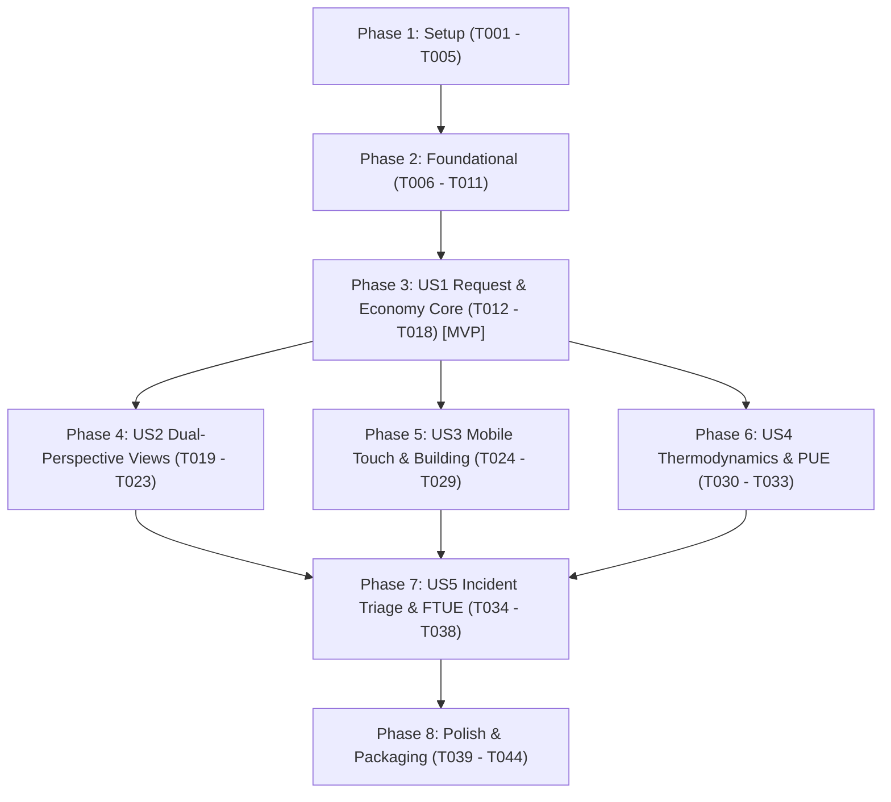

# Tasks: Core Simulation Engine & Mobile Cockpit

**Feature**: `001-core-sim-mobile`  
**Date**: 2026-10-14  
**Spec Reference**: [specs/001-core-sim-mobile/spec.md](./spec.md)  
**Plan Reference**: [specs/001-core-sim-mobile/plan.md](./plan.md)  
**Constitution**: Governed by [.specify/memory/constitution.md](../../.specify/memory/constitution.md)

---

## Phase 1: Setup (Shared Infrastructure & Tooling)

**Purpose**: Initialize directory layouts, deployment descriptors, and shared event contracts.

- [X] T001 Create source and test directory structure per plan in `src/core/`, `src/render/`, `src/scenes/`, `src/ui/`, `src/storage/`, and `tests/`
- [X] T002 [P] Create multi-stage `Dockerfile` with `node:22-alpine` build stage and `nginx:alpine` runner with custom Nginx gzip/brotli config for Coolify deployment
- [X] T003 [P] Initialize Capacitor mobile project configuration in `capacitor.config.json` with appId `id.web.arie.cloudsim` and webDir `dist`
- [X] T004 [P] Implement decoupled Pub/Sub `EventBus` adhering to [contracts/engine-event-contract.json](./contracts/engine-event-contract.json) in `src/core/events/EventBus.js`
- [X] T005 [P] Create domain constants, component catalog metadata, and node enums (`NodeType`, `NodeStatus`, `PacketType`) in `src/core/sim/Constants.js`

---

## Phase 2: Foundational (Blocking Prerequisites)

**Purpose**: Core simulation clock, state persistence, and rendering math that MUST be complete before any user story can be implemented.

**⚠️ CRITICAL**: No user story work can begin until this foundational phase is complete.

- [X] T006 Implement unit tests for `EventBus` in `tests/event-bus.test.js`
- [X] T007 Implement 2.5D Isometric projection and inverse screen-to-grid raycasting math in `src/render/IsoMath.js`
- [X] T008 [P] Implement unit tests for isometric math in `tests/iso-math.test.js`
- [X] T009 [P] Implement pre-allocated particle object pooling manager (`ParticlePool`, capacity 5,000) for WebGL memory stability in `src/render/ParticlePool.js`
- [X] T010 Implement client state persistence (`IndexedDB` with LocalStorage fallback) adhering to [contracts/save-state-schema.json](./contracts/save-state-schema.json) in `src/storage/StatePersistence.js`
- [X] T011 [P] Implement unit tests for state serialization and 8-hour offline catch-up calculations in `tests/state-persistence.test.js`

**Checkpoint**: Foundation ready — User Story implementation can now proceed.

---

## Phase 3: User Story 1 - Real-Time Request Lifecycle & Headless Economic Loop (Priority: P1) 🎯 MVP

**Goal**: Deliver the core headless mathematical simulation loop: incoming customer traffic flows through connected services, calculates additive latency, produces revenue per `200 OK`, deducts OPEX and power bills, and enforces SLA penalties.

**Independent Test**: Headless verification via `npm test` injecting synthetic traffic into `SimulationEngine`, verifying cash grows under healthy traffic ($0.0002 per request) and SLA degrades under overloaded drops.

### Tests for User Story 1 (TDD - Write First) ⚠️

- [X] T012 [P] [US1] Unit test for TrafficEngine (additive latency equation, packet queue limits, drop rate) in `tests/traffic-engine.test.js`
- [X] T013 [P] [US1] Unit test for EconomicEngine (micro-cents balance, OPEX deduction, SLA penalties, 30s bankruptcy timer) in `tests/economic-engine.test.js`
- [X] T014 [US1] Unit test for fixed-timestep simulation tick runner (60 ticks/s) in `tests/simulation-engine.test.js`

### Implementation for User Story 1

- [X] T015 [P] [US1] Implement `TrafficEngine` managing request packets, routing paths, hop counts (max 16), and queue buffers in `src/core/sim/TrafficEngine.js`
- [X] T016 [P] [US1] Implement `EconomicEngine` computing net cashflow ($1\text{ USD} = 1,000,000\text{ micro-cents}$), hardware leases, and SLA reputation in `src/core/sim/EconomicEngine.js`
- [X] T017 [US1] Implement `SimulationEngine` integrating `TrafficEngine`, `EconomicEngine`, and fixed 60 ticks/s accumulator loop in `src/core/sim/SimulationEngine.js`
- [X] T018 [US1] Wire `SimulationEngine` to emit `STATE_SNAPSHOT_EMITTED` events over `EventBus` every tick

**Checkpoint**: User Story 1 is fully functional and testable headlessly in Node.js with 100% test pass.

---

## Phase 4: User Story 2 - Dual-Perspective Presentation Switching (Priority: P1)

**Goal**: Deliver seamless, zero-state-loss viewport switching between the 2D Logical Cloud Routing canvas (`TopologyScene`) and the 2.5D Isometric Data Center canvas (`FacilityScene`) via a HUD toggle pill.

**Independent Test**: In browser/device, tapping the view toggle switches the rendered scene in $< 100\text{ ms}$ while packets in flight, node metrics, and audio remain in sync.

### Tests for User Story 2 (TDD - Write First) ⚠️

- [X] T019 [P] [US2] Unit test verifying dual-scene state synchronization and snapshot propagation over `EventBus` in `tests/dual-view-sync.test.js`

### Implementation for User Story 2

- [X] T020 [P] [US2] Implement `TopologyScene` rendering 2D orthogonal node graph, queue depth gauges, and flowing packet particles in `src/scenes/TopologyScene.js`
- [X] T021 [P] [US2] Implement `FacilityScene` rendering 2.5D isometric data center floor grid, server racks, and CRAC units in `src/scenes/FacilityScene.js`
- [X] T022 [US2] Implement `CockpitHUD` top bar with view-switcher pill (`[Topology] | [Facility]`), cash ticker, RPS, PUE, and SLA indicators in `src/ui/CockpitHUD.js`
- [X] T023 [US2] Connect `CockpitHUD` view toggle events to Phaser SceneManager sleep/wake transitions in `src/main.js`

**Checkpoint**: User Stories 1 AND 2 operate in tandem with zero visual desynchronization.

---

## Phase 5: User Story 3 - Mobile Touch Navigation & Drag-and-Drop Building (Priority: P2)

**Goal**: Deliver touch-first mobile controls: single-finger pan with inertia, two-finger pinch-to-zoom ($0.5\times - 2.5\times$), collapsible bottom procurement drawer, snap-to-grid placement, and point-to-point cable wiring with $48 \times 48\text{ dp}$ targets.

**Independent Test**: Touch gestures smoothly scale and pan viewport without input conflicts; components dragged from palette snap to grid tiles; dragging between node ports forms orthogonal connection cables.

### Tests for User Story 3 (TDD - Write First) ⚠️

- [X] T024 [P] [US3] Unit test for touch gesture state machine transitions (IDLE, PANNING, PINCHING, DRAGGING, WIRING) in `tests/touch-fsm.test.js`

### Implementation for User Story 3

- [X] T025 [P] [US3] Implement `MobileTouchFSM` handling touch pointer events, pinch distance ratios, and gesture disambiguation in `src/ui/MobileTouchFSM.js`
- [X] T026 [P] [US3] Implement `BuildDrawer` collapsible bottom tray with category tabs (Ingress, Compute, Storage, Facilities) and $48 \times 48\text{ dp}$ touch targets in `src/ui/BuildDrawer.js`
- [X] T027 [US3] Implement snap-to-grid preview ghost and placement validator in `src/render/GridSnapper.js`
- [X] T028 [US3] Implement drag-to-wire orthogonal cable routing and connection validation between node ports in `src/render/CableRenderer.js`
- [X] T029 [US3] Update `style.css` with safe-area insets (`env(safe-area-inset-*)`), landscape locking, and glassmorphic HUD styling

**Checkpoint**: Player can navigate and construct complete topologies using only mobile touch inputs.

---

## Phase 6: User Story 4 - Facility Thermodynamics, Power & PUE Management (Priority: P2)

**Goal**: Deliver thermodynamic and electrical physics: server racks generate heat (BTU/h) from workload wattage, CRAC chillers circulate cold CFM airflow, and dynamic PUE calculation penalizes inefficient cooling layouts.

**Independent Test**: Headless tests verify that adding compute load raises rack temperature, placing CRAC units lowers temperature, and PUE ratio updates dynamically ($\text{Total Power} / \text{IT Power}$).

### Tests for User Story 4 (TDD - Write First) ⚠️

- [X] T030 [P] [US4] Unit test for ThermalEngine (BTU calculation, CRAC CFM cooling diffusion, PUE ratio, thermal throttling trip at 45°C) in `tests/thermal-engine.test.js`

### Implementation for User Story 4

- [X] T031 [P] [US4] Implement `ThermalEngine` computing rack wattage, ambient room heat diffusion, and PUE in `src/core/sim/ThermalEngine.js`
- [X] T032 [US4] Integrate `ThermalEngine` into `SimulationEngine` tick loop and map logical pod workloads to physical server racks in `src/core/sim/SimulationEngine.js`
- [X] T033 [US4] Implement visual heat dissipation overlay, thermal warning indicators, and smoke particle effects on overheating racks in `src/scenes/FacilityScene.js`

**Checkpoint**: Tycoon datacenter physics active; heat and PUE directly impact operational costs and compute throughput.

---

## Phase 7: User Story 5 - Real-Time Incident Triage & 30-Second FTUE (Priority: P3)

**Goal**: Deliver the emergency crisis triage system and the guided 30-second Day-1 onboarding walkthrough ("Black Friday Outage") with haptic/audible alert cues and contextual quick-action remediations.

**Independent Test**: Launching new game session triggers initial 502 bottleneck; tapping guided cache recommendation resolves incident in $< 30\text{ seconds}$, awarding cash and leveling up player.

### Tests for User Story 5 (TDD - Write First) ⚠️

- [X] T034 [P] [US5] Unit test for ChaosDirector (incident spawner, SLA impact, remediation resolution validation) in `tests/chaos-director.test.js`

### Implementation for User Story 5

- [X] T035 [P] [US5] Implement `ChaosDirector` supporting initial 4 incident types (Memory Leak, Flash Sale Surge, Overheating, Cache Stampede) in `src/core/sim/ChaosDirector.js`
- [X] T036 [P] [US5] Implement `IncidentBar` emergency triage banner with incident countdown, severity badge, and auto-camera recenter button in `src/ui/IncidentBar.js`
- [X] T037 [US5] Implement 30-second guided FTUE tutorial overlay (finger pointer, highlight mask, cache placement prompt) in `src/ui/FTUETutorial.js`
- [X] T038 [US5] Implement contextual component inspector sheet displaying live health, restart button, and scaling controls in `src/ui/NodeInspector.js`

**Checkpoint**: Complete crisis triage loop and onboarding tutorial fully playable on mobile touchscreens.

---

## Phase 8: Polish, Multi-Target Deployment & Verification

**Purpose**: End-to-end verification across web, Coolify containerization, Android APK packaging, and performance benchmarks.

- [X] T039 [P] Implement headless 10,000-tick stress benchmark script asserting zero float drift in `tests/stress-sim.benchmark.js`
- [X] T040 Verify Coolify container build: execute local Docker multi-stage build and assert HTTP 200 OK on Nginx endpoint
- [X] T041 [P] Configure Android Capacitor build scripts and verify debug APK compilation via `./gradlew assembleDebug`
- [X] T042 [P] Configure PWA manifest (`manifest.json`) and iOS touch icons for full-screen Safari "Add to Home Screen"
- [X] T043 Execute full quickstart validation scenarios per `specs/001-core-sim-mobile/quickstart.md`
- [X] T044 Verify 60 FPS mobile WebGL performance with 3,000 active particles and clean up working tree

---

## Dependencies & Execution Order

### Parallel Opportunities

- **Phase 1 Setup**: Tasks `T002`, `T003`, `T004`, `T005` can all be executed in parallel.
- **Phase 2 Foundation**: Tasks `T008`, `T009`, `T011` can be implemented in parallel once `T007` and `T010` are established.
- **Phase 3 US1 TDD**: Tests `T012`, `T013` run in parallel; models `T015`, `T016` can be developed in parallel before `T017` integration.
- **Phase 4–6 User Stories**: Once Phase 3 (US1 Core) is complete, `US2` (Scenes), `US3` (Touch Controls), and `US4` (Thermodynamics) can be implemented in parallel across separate subagents.

---

## Implementation Strategy: MVP First

1. **Step 1:** Complete Phase 1 (Setup) and Phase 2 (Foundational).
2. **Step 2:** Complete Phase 3 (User Story 1 - Headless Engine).  
   *STOP & VALIDATE:* Run `npm test` to verify deterministic simulation math in Node.js.
3. **Step 3:** Complete Phase 4 (User Story 2 - Dual-Perspective Views) and Phase 5 (User Story 3 - Touch Controls).  
   *STOP & VALIDATE:* Run `npm run dev` to test interactive node building and view switching in browser.
4. **Step 4:** Complete Phase 6 (Thermodynamics & PUE) and Phase 7 (Incident Triage & FTUE).
5. **Step 5:** Complete Phase 8 (Coolify Docker build, Android Capacitor packaging, and 10,000-tick benchmark).
