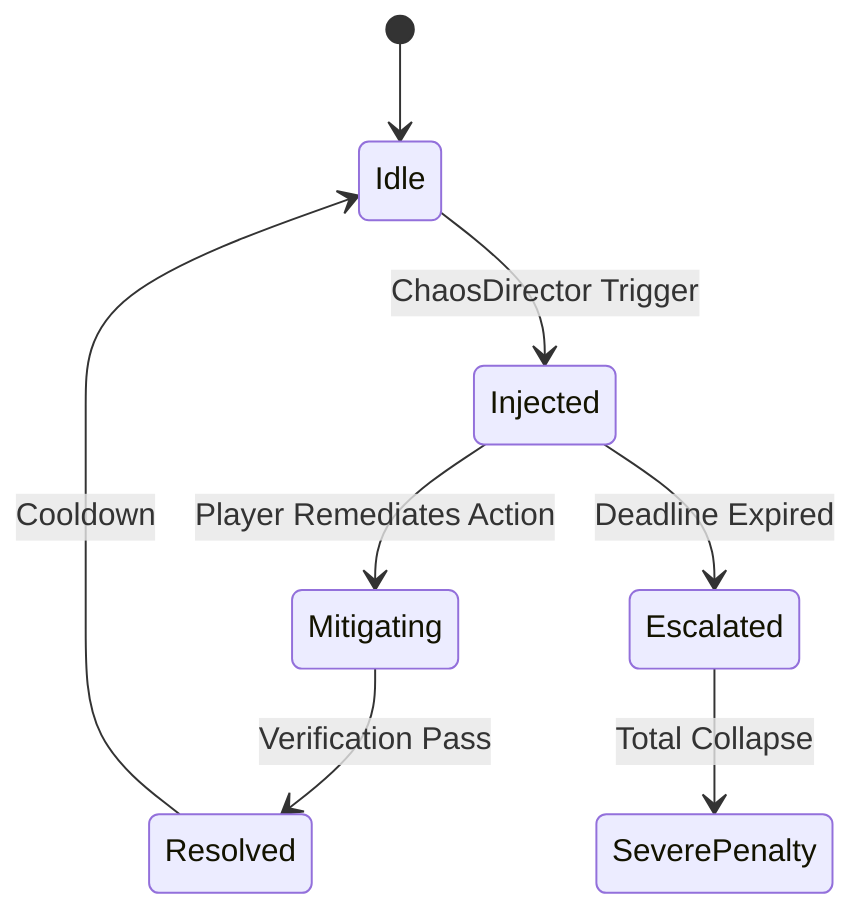

# Technical Research: Advanced Components, Power Grid Physics & Chaos Scenarios

**Feature**: `002-advanced-infra-chaos`  
**Date**: 2026-10-14  
**Authoritative References**: [CLOUD_DATACENTER_SIMULATION_GAME_DESIGN.md](../../docs/CLOUD_DATACENTER_SIMULATION_GAME_DESIGN.md) (§3, §4.1, §5.1)

---

## 1. Mathematical Algorithms & Physics Models

### 1.1 WAF Inspection & Payload Evaluation
- **Latency Equation**: $L_{\text{WAF}} = 4\text{ms}$ per packet.
- **Filtering Logic**: Incoming packets with `packet.type === 'ATTACK_SQLI' || packet.type === 'ATTACK_DDOS'` are evaluated against active WAF rulesets:
  - If WAF is deployed and operational: attack packets are dropped at perimeter; `blockedAttacks` count increments; database is protected.
  - If WAF is absent or disabled: exploit packets penetrate to compute/database, causing immediate 500 errors and SLA degradation.

### 1.2 CDN Edge Caching Model
- **Edge Hit Ratio ($P_{\text{Hit}}$)**: Defaults to $0.85$ (85%) for GET requests when CDN is active.
- **Latency Model**:
  $$\text{Latency}_{\text{CDN}} = P_{\text{Hit}} \times 12\text{ms} + (1 - P_{\text{Hit}}) \times (\text{Origin Compute Latency} + \text{DB Latency})$$
- **Origin Offload**: For every cache hit, no packet is routed to downstream Compute Pods or Databases, preventing queue saturation during traffic surges.

### 1.3 Message Broker Decoupling (Queue Buffer $Q_{\text{depth}}$)
- **Leaky Bucket Drain Model**:
  $$\Delta Q = \text{Incoming Packets} - \min(Q_{\text{depth}}, \text{Consumer Drain Capacity})$$
  - If $Q_{\text{depth}} < Q_{\text{capacity}}$: Packets are buffered with zero packet drops.
  - If $Q_{\text{depth}} \ge Q_{\text{capacity}}$: Buffer overflows, emitting HTTP 504 Gateway Timeout drops.

### 1.4 Power Grid Blackout & UPS Discharge Physics
- **Electrical IT Load**:
  $$P_{\text{IT}} = \sum (\text{Node Base Watts} + \text{Utilization} \times \text{Peak Watts}) / 1000 \quad [\text{kW}]$$
- **Total Facility Power ($P_{\text{Total}}$)**:
  $$P_{\text{Total}} = P_{\text{IT}} \times \text{PUE} \quad [\text{kW}]$$
- **UPS Battery Discharge Rate**:
  $$\text{Charge Drain per Tick} = \frac{P_{\text{Total}}}{3600 \times 60} \quad [\text{kWh}]$$
- **UPS Runtime Equation**:
  $$\text{Runtime Remaining (Seconds)} = \frac{\text{Current Charge (kWh)}}{P_{\text{Total}} (\text{kW})} \times 3600 \times 0.95$$
- **Diesel Generator Switchover**:
  - Spool-up time: 3.0 seconds (180 ticks).
  - Power Output: Generates up to 150 kW per generator.
  - Fuel Consumption: 0.05 Liters/second per generator while running under load.

---

## 2. Chaos Incidents State Machines

### 2.1 Volumetric DDoS Flood
- **Trigger**: Botnet flood (5,000 requests/s injected directly at Ingress).
- **Remediation Action**: `ENABLE_DDOS_SHIELD` (Activates Scrubbing Center, filters 99% malicious packets, costs $0.05/s).

### 2.2 SQL Injection Breach
- **Trigger**: Malicious query packet penetrates without WAF.
- **Remediation Action**: `DEPLOY_WAF_RULESET` (Patches SQLi signature, isolates corrupted connection pool).

### 2.3 Database Split-Brain
- **Trigger**: Network partition between DB master and replica.
- **Remediation Action**: `TRIGGER_RAFT_QUORUM` (Forces leader election, fences off isolated minor partition).

### 2.4 Server Rack Overheating Fire
- **Trigger**: Local rack temperature exceeds 45°C due to chiller failure.
- **Remediation Action**: `EMERGENCY_EXHAUST_PURGE` (Turns on high-velocity ceiling fans, routes traffic away from hot rack).

### 2.5 Utility Power Grid Blackout
- **Trigger**: Municipal mains power cut to 0 kW.
- **Remediation Action**: `START_DIESEL_GENERATOR` (Spools up backup generator before UPS battery hits 0%).
