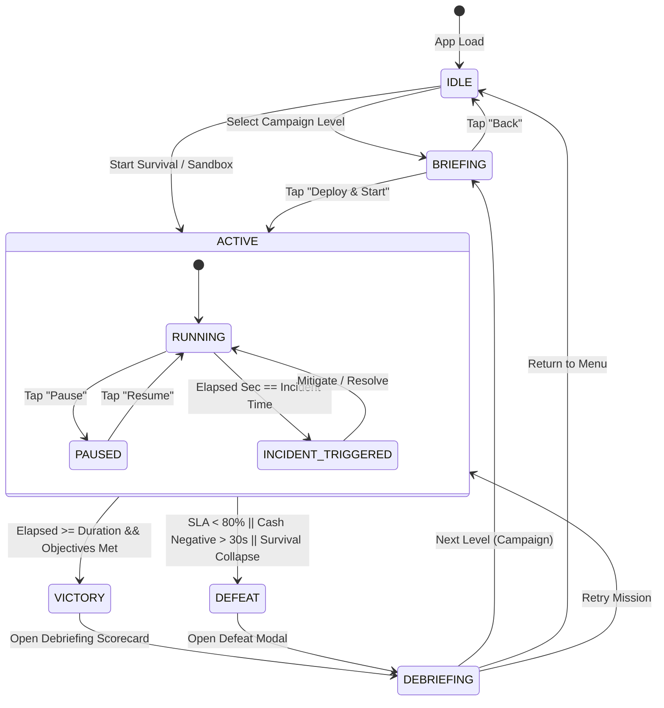

# Data Model: Game Modes & SRE Career Campaign

**Feature**: `specs/003-game-modes-career`  
**Date**: 2026-10-14  
**Author**: Antigravity  

---

## 1. Entities & Types

### 1.1 Game Mode Definitions

```typescript
export type GameModeType = 'CAMPAIGN' | 'SURVIVAL' | 'SANDBOX';

export type GameSessionState = 
  | 'IDLE' 
  | 'BRIEFING' 
  | 'ACTIVE' 
  | 'PAUSED' 
  | 'VICTORY' 
  | 'DEFEAT';
```

---

### 1.2 Campaign Level Configuration

```typescript
export interface StarterNodeConfig {
  id: string;
  type: string; // e.g. 'ingress', 'compute', 'database', 'loadbalancer', 'cache', 'waf'
  tier?: 'micro' | 'standard' | 'large';
  gridX: number;
  gridY: number;
}

export interface StarterConnectionConfig {
  sourceId: string;
  targetId: string;
}

export interface StarterFacilityConfig {
  id: string;
  type: string; // e.g. 'rack', 'crac', 'ups', 'generator', 'pdu'
  gridX: number;
  gridY: number;
}

export interface ScriptedIncidentConfig {
  triggerAtSec: number;
  incidentType: string; // e.g. 'POD_OOM', 'CACHE_STAMPEDE', 'DDOS_ATTACK', 'SQLI_ATTACK', 'SPLIT_BRAIN', 'AZ_OUTAGE', 'RACK_FIRE', 'GRID_BLACKOUT'
  targetNodeId?: string;
  severity?: 'LOW' | 'MEDIUM' | 'HIGH' | 'CRITICAL';
  description: string;
}

export interface LevelObjectivesConfig {
  durationSec: number;
  minSlaPercent: number;          // e.g. 99.0 for 1 star, 99.5 for 2 stars
  minProcessedRequests: number;  // e.g. 500
  targetCashBonusMicroCents: number; // e.g. $25.00 (25000000 microcents) for 3rd star
  maxErrorRatePercent?: number;  // e.g. 2.0%
}

export interface CampaignLevelConfig {
  levelNumber: number;
  id: string;
  title: string;
  subtitle: string;
  lore: string;
  startingCashMicroCents: number;
  starterNodes: StarterNodeConfig[];
  starterConnections: StarterConnectionConfig[];
  starterFacilities?: StarterFacilityConfig[];
  objectives: LevelObjectivesConfig;
  scriptedIncidents: ScriptedIncidentConfig[];
}
```

---

### 1.3 Active Objective Tracking State

```typescript
export interface ObjectiveRuntimeState {
  levelNumber?: number;
  mode: GameModeType;
  state: GameSessionState;
  elapsedSec: number;
  durationSec: number;
  currentSlaPercent: number;
  cumulativeRequestsProcessed: number;
  currentCashMicroCents: number;
  pendingIncidents: ScriptedIncidentConfig[];
  activeIncidents: Array<{ incidentType: string; remainingSec: number }>;
  starsEarned: number; // 0 to 3
  failureReason?: string;
}
```

---

### 1.4 Career Persistence Model

```typescript
export interface PlayerCareerRecord {
  unlockedLevel: number;
  levelStars: Record<number, number>; // levelNumber -> stars (1-3)
  survivalHighScoreSec: number;
  survivalMaxRequests: number;
  totalCareerCashEarnedMicroCents: number;
  lastPlayedTimestamp: number;
}
```

---

## 2. State Transition Machine



---

## 3. Storage Validation Rules

1. `unlockedLevel` MUST be an integer between $1$ and $5$. Default is $1$.
2. `levelStars[N]` MUST be an integer between $0$ and $3$. Stars can only increase (new high score replaces old score if strictly greater).
3. `survivalHighScoreSec` and `survivalMaxRequests` update whenever a Survival session ends with a value strictly greater than the recorded high score.
4. If `CareerStorage` reads corrupted JSON or missing fields, it safely initializes with default values without crashing.
