# Data Model: Procedural Audio, Mobile Haptics & Native Packaging

**Feature**: `specs/004-audio-haptics-mobile`  
**Date**: 2026-10-14  
**Author**: Antigravity  

---

## 1. Entities & Types

### 1.1 Audio & Haptic Settings Configuration

```typescript
export interface AudioHapticSettings {
  masterVolume: number;    // 0.0 to 1.0 (default: 0.8)
  sfxVolume: number;       // 0.0 to 1.0 (default: 1.0)
  ambientVolume: number;   // 0.0 to 1.0 (default: 0.6)
  isMasterMuted: boolean;  // default: false
  isAmbientMuted: boolean; // default: false
  isSfxMuted: boolean;     // default: false
  isHapticsEnabled: boolean; // default: true
}
```

---

### 1.2 Sound Effects & Audio Event Enums

```typescript
export type SfxType =
  | 'UI_CLICK'          // Tactile button / tab tap
  | 'NODE_PLACED'       // Grid component placement harmonic blip
  | 'NODE_REMOVED'      // Component sold / deleted thud
  | 'CABLE_CONNECTED'   // Cable snapped to node
  | 'PACKET_SUCCESS'    // 200 OK request resolved
  | 'PACKET_DROP'       // Capacity overflow / 502 drop
  | 'INCIDENT_ALARM'    // Urgent two-tone emergency siren
  | 'INCIDENT_RESOLVED' // Positive remediation chime
  | 'LEVEL_VICTORY'     // 4-note ascending major arpeggio
  | 'LEVEL_DEFEAT';     // 3-note descending minor triad
```

---

### 1.3 Haptic Feedback Patterns

```typescript
export type HapticStyle =
  | 'LIGHT'    // 10-15ms subtle tap (UI buttons, grid snap)
  | 'MEDIUM'   // 25-30ms mechanical click (cable connect, node inspect)
  | 'HEAVY'    // 50ms solid thud (node removal, incident remediation)
  | 'WARNING'  // [80ms, 40ms, 80ms] pulsing alarm (incident triggered, SLA breach)
  | 'SUCCESS'; // [20ms, 30ms, 40ms] rhythmic fanfare (level victory, star earned)
```

---

### 1.4 Native App Lifecycle State

```typescript
export interface MobileAppState {
  isActive: boolean;
  isBackgrounded: boolean;
  activeModalsStack: string[]; // IDs of open dialogs (for back button popping)
  lastAutoSavedTimestamp: number;
}
```

---

## 2. Event-Driven Audio & Haptics Wiring

```mermaid
flowchart LR
    subgraph SimEngine["Simulation & UI Events"]
        E1["NODE_PLACED"]
        E2["NODES_CONNECTED"]
        E3["PACKET_PROCESSED"]
        E4["PACKET_DROPPED"]
        E5["INCIDENT_TRIGGERED"]
        E6["INCIDENT_MITIGATED"]
        E7["LEVEL_VICTORY"]
        E8["LEVEL_DEFEAT"]
    end

    subgraph EventBus["EventBus Pub/Sub"]
        BUS["globalEventBus"]
    end

    subgraph AudioEngine["AudioManager (Procedural)"]
        S_CLICK["playSfx('UI_CLICK')"]
        S_PLACE["playSfx('NODE_PLACED')"]
        S_CHORD["playSfx('CABLE_CONNECTED')"]
        S_PING["playSfx('PACKET_SUCCESS')"]
        S_DROP["playSfx('PACKET_DROP')"]
        S_ALARM["startSiren() / stopSiren()"]
        S_VICT["playSfx('LEVEL_VICTORY')"]
        S_DEF["playSfx('LEVEL_DEFEAT')"]
        S_AMB["modulateAmbient(watts, pue)"]
    end

    subgraph Haptics["HapticsManager"]
        H_LIGHT["trigger('LIGHT')"]
        H_MED["trigger('MEDIUM')"]
        H_WARN["trigger('WARNING')"]
        H_SUCC["trigger('SUCCESS')"]
    end

    SimEngine --> BUS
    BUS --> AudioEngine
    BUS --> Haptics
```



---

## 3. Storage Validation Rules

1. `masterVolume`, `sfxVolume`, and `ambientVolume` MUST be numbers clamped between $0.0$ and $1.0$.
2. `isMasterMuted`, `isAmbientMuted`, `isSfxMuted`, and `isHapticsEnabled` MUST be booleans.
3. If stored JSON is missing or malformed, fallback defaults are used without throwing errors.
