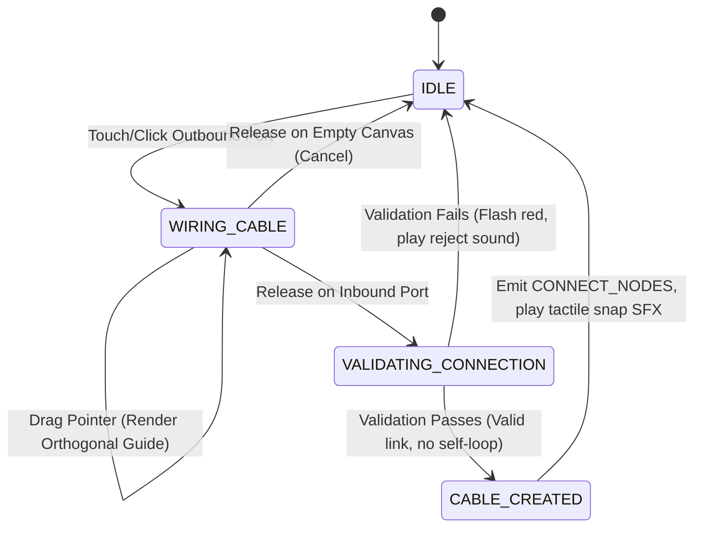
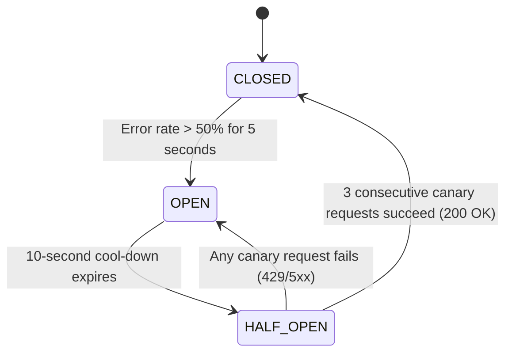
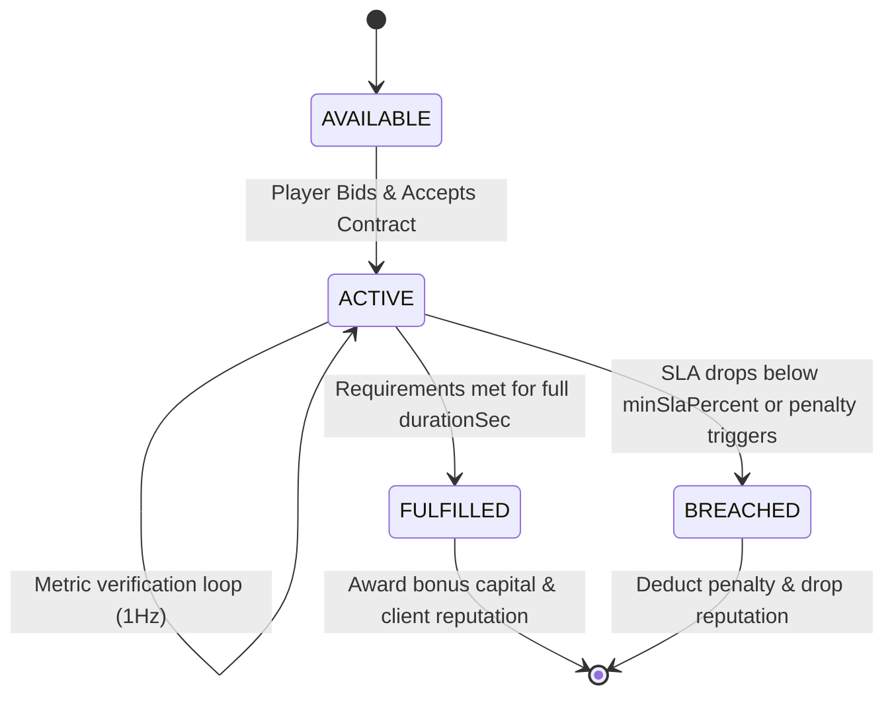

# Phase 1 Data Model: Production-Grade Readiness & Polish

**Feature**: `005-production-grade-readiness`  
**Date**: 2026-10-15  
**Status**: Completed  
**Goal**: Define schemas, data models, entities, and state machine transitions for all production subsystems.

---

## 1. Entities & Data Schemas

### 1.1 SRE Tech Tree Node (`TechTreeNode`)
Represents an unlockable node within the 4-era architectural research lab.

```typescript
export interface TechTreeNode {
  id: string; // e.g., 'tech_redis_cache', 'tech_k8s_hpa'
  era: 1 | 2 | 3 | 4; // 1: Bare Metal, 2: Scale-Out, 3: Cloud-Native, 4: Hyperscale
  name: string;
  description: string;
  researchCostMicroCents: number; // e.g., 25_000_000 ($25.00)
  prerequisiteTechIds: string[]; // Parent techs required before unlocking
  unlockedComponentTypes: string[]; // NodeTypes / FacilityComponentTypes unlocked
  unlockedMechanics: string[]; // e.g., ['AUTOSCALING_HPA', 'CIRCUIT_BREAKER']
  isUnlocked: boolean;
  unlockedAtTimestamp?: number;
}
```

### 1.2 Client Enterprise Service Contract (`ClientContract`)
Represents an active or available enterprise customer contract with SLA requirements and financial rewards/penalties.

```typescript
export interface ClientContract {
  id: string; // e.g., 'contract_neovault_01'
  clientName: string; // e.g., 'NeoVault Fintech Bank'
  clientTier: 'STARTUP' | 'GROWTH' | 'ENTERPRISE' | 'HYPERSCALE';
  description: string;
  requirements: {
    minRps: number; // e.g., 2500
    maxLatencyMs: number; // e.g., 30
    minSlaPercent: number; // e.g., 99.99
    requiredComponents?: string[]; // e.g., ['WAF_SHIELD', 'DATABASE_SQL']
    durationSec: number; // Term length, e.g., 180s
  };
  financials: {
    payoutPerSecMicroCents: number; // Revenue stream while healthy
    bonusMicroCents: number; // One-time completion payout
    penaltyPerBreachMicroCents: number; // Instant deduction upon SLA violation
  };
  state: 'AVAILABLE' | 'ACTIVE' | 'FULFILLED' | 'BREACHED' | 'EXPIRED';
  elapsedSec: number;
  healthConsecutiveSec: number;
}
```

### 1.3 Architecture Blueprint Exchange (`BlueprintData`)
Serialized payload for export/importing architectures as Factorio-style Base64 hash strings.

```typescript
export interface BlueprintData {
  version: '1.0.0';
  generator: 'cloudsim-blueprint';
  title: string;
  description?: string;
  createdAtTimestamp: number;
  nodes: Array<{
    id: string;
    type: string;
    gridX: number;
    gridY: number;
    name?: string;
    autoscaling?: {
      enabled: boolean;
      minInstances: number;
      maxInstances: number;
      targetCpuUtil: number;
    };
  }>;
  connections: Array<{
    id: string;
    sourceNodeId: string;
    targetNodeId: string;
    isOrthogonal: boolean;
  }>;
  facilityComponents?: Array<{
    id: string;
    type: string;
    isoX: number;
    isoY: number;
  }>;
}
```

### 1.4 APM Real-Time Observability Snapshot (`APMSnapshot`)
Rolling 60-second window data structure for live SRE telemetry and root-cause analysis.

```typescript
export interface APMSnapshot {
  timestamp: number;
  rollingWindowSec: 60;
  overall: {
    currentRps: number;
    p50LatencyMs: number;
    p95LatencyMs: number;
    p99LatencyMs: number;
    slaReputationPercent: number;
    statusCodes: {
      http200: number;
      http429: number;
      http500: number;
      http502: number;
      http504: number;
    };
  };
  componentMetrics: Map<string, {
    nodeId: string;
    rps: number;
    cpuUtilization: number;
    queueDepth: number;
    queueCapacity: number;
    droppedPacketsCount: number;
    temperatureCelsius?: number;
  }>;
}
```

### 1.5 Multi-Slot Storage Manifest (`SaveManifest`)

```typescript
export interface SaveManifest {
  activeSlot: string; // 'slot_1' | 'slot_2' | 'slot_3' | 'autosave'
  slots: Record<string, {
    slotId: string;
    title: string;
    savedAtTimestamp: number;
    mode: 'CAMPAIGN' | 'SURVIVAL' | 'SANDBOX';
    currentLevelNumber?: number;
    cashMicroCents: number;
    nodeCount: number;
    slaPercent: number;
  }>;
}
```

---

## 2. State Machine Transitions

### 2.1 Manual Port-to-Port Wiring State Machine


### 2.2 Circuit Breaker State Machine


### 2.3 Client Enterprise Contract Lifecycle

