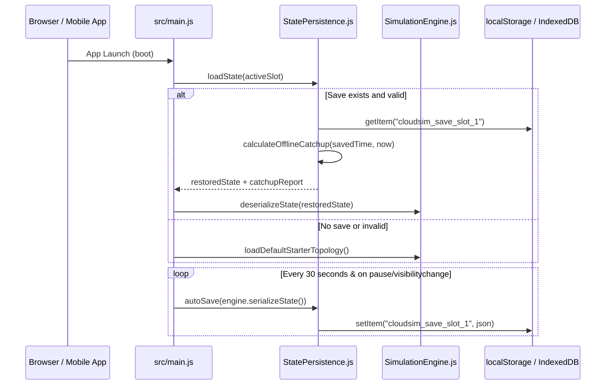
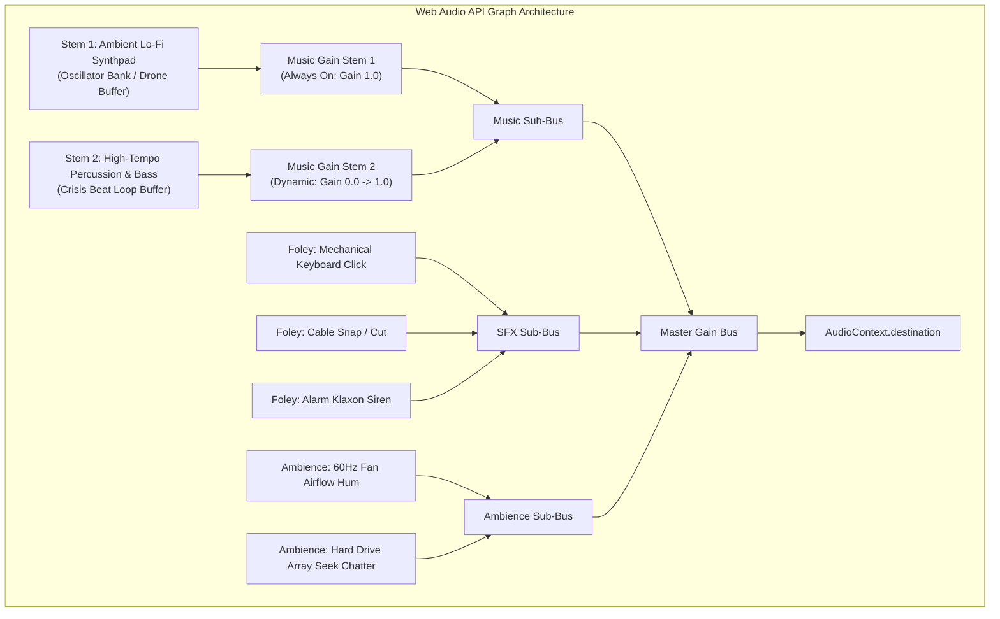

# Phase 0 Technical Research: Production-Grade Readiness & Polish

**Feature**: `005-production-grade-readiness`  
**Date**: 2026-10-15  
**Status**: Completed  
**Goal**: Resolve all architectural decisions and technical implementation patterns required to transform the prototype into a production-grade commercial game.

---

## 1. Coordinate Grid System & Campaign Level Alignment

### Problem Analysis
In `src/core/sim/CampaignLevels.js`, starter nodes for Levels 1–5 were authored with raw pixel coordinates (`gridX: 100, gridY: 200`, `gridX: 300, gridY: 200`, etc.). However, in `src/scenes/TopologyScene.js` (lines 216–218), node positions are computed as:
```javascript
const posX = node.gridX * TILE_PX; // TILE_PX = 80
const posY = node.gridY * TILE_PX;
```
Multiplying $100 \times 80 = 8,000\text{px}$ places starter nodes off-screen in outer space.

### Solution Pattern
Standardize all campaign starter nodes to discrete integer grid coordinates ($2 \le x \le 12, 2 \le y \le 8$) consistent with `main.js`:
- Level 1: Ingress `(2, 4)`, App Pod `(5, 4)`, Postgres DB `(8, 4)`.
- Level 2: Ingress `(2, 4)`, LB `(4, 4)`, Pod A `(6, 3)`, Pod B `(6, 5)`, Postgres DB `(9, 4)`.
- Level 3: Ingress `(2, 4)`, WAF `(4, 4)`, LB `(6, 4)`, Pod `(8, 4)`, Postgres DB `(10, 4)`.
- Level 4: Multi-Region Ingress A `(2, 2)`, Ingress B `(2, 6)`, DNS `(4, 4)`, Gateways `(6, 2)` & `(6, 6)`, Pods `(8, 2)` & `(8, 6)`, Shared DB `(11, 4)`.
- Level 5: Complete greenfield data center facility floor grid ($12 \times 12$ isometric tiles).

---

## 2. State Persistence, Session Restore & Multi-Slot Saves

### Problem Analysis
`src/storage/StatePersistence.js` already provides schema validation (`save-state-schema.json`), serialization, and 8-hour offline catch-up, but was never connected in `src/main.js`. Sessions reset on page refresh.

### Architecture Design


### Save Slot Structure
- `cloudsim_save_slot_1`: Primary Campaign / Career save.
- `cloudsim_save_slot_2`: Sandbox architecture design.
- `cloudsim_save_slot_3`: Experimental / Chaos testing.
- `cloudsim_save_autosave`: Rolling fallback backup saved on pause.

---

## 3. Manual Port-to-Port Cable Wiring Tool

### Touch & Mouse Interaction Flow
1. **Hover / Touch Port**: Each node renders 2 dedicated port connection targets:
   - Inbound Port: Left center dot $(-36, 0)$.
   - Outbound Port: Right center dot $(+36, 0)$.
2. **Gesture Dragging (`WIRING_CABLE`)**:
   - Touching/clicking an Outbound port transitions `MobileTouchFSM` into `WIRING_CABLE` state.
   - Panning the camera is suppressed.
   - An interactive live rubber-band stepped orthogonal line renders from the source port to pointer position.
3. **Drop on Target Port**:
   - Releasing over an Inbound port of a destination node calls `CableRenderer.validateConnection(sourceNode, targetNode, connections)`.
   - If valid: Emits `CONNECT_NODES` to `SimulationEngine`, creates the connection, plays tactile cable snap audio + haptic tap, and renders the permanent orthogonal conduit.
   - If invalid (self-loop, duplicate, targeting ingress): Cable dissolves with red sparks and plays rejection sound.

---

## 4. Visual Overhaul: Vector Sci-Fi Cards & Orthogonal Conduit Shaders

### Eliminating OS-Dependent Emojis
- System emojis (`⚙️`, `🌐`, `🔀`, `🗄️`, `📦`) are replaced with custom procedural vector canvas drawings and SVG glyphs:
  - **Client Ingress**: Concentric globe broadcast rings with emitting pulses.
  - **Load Balancer**: Split-path routing trident with directional indicators.
  - **Compute Pod**: Microchip die with active core activity LEDs.
  - **Cache Cluster**: Hexagonal crystal facet with glow intensity based on cache hit rate.
  - **Database SQL**: Cylindrical multi-platter disk drum with animated spin lines.
  - **WAF Shield**: Angular hex shield barrier with energy wave ripples.
  - **Message Broker**: Interlinked queue pip tubes with discrete buffered dots.

### Stepped Manhattan Neon Conduits
- Use `CableRenderer.getOrthogonalWaypoints(x1, y1, x2, y2)` to generate exact 90-degree stepped paths.
- Render conduits with 3 visual layers:
  1. Base outer sleeve: Dark slate stroke (width: 4px, color: `#1e293b`).
  2. Core fiber conduit: Dynamic colored neon stroke (width: 2px, blue `#38bdf8` $\rightarrow$ amber `#f59e0b` at 80% saturation $\rightarrow$ red `#ef4444` when dropping packets).
  3. Flow particle pulses: Moving directional light pulses along the orthogonal segments.

### Floating Financial & Metric Feedback
- Object-pooled text particles in `TopologyScene`:
  - `+$0.002` (emerald green) floats upward on processed requests.
  - `-$0.015/s` (muted grey) on OPEX tick deductions.
  - `-$500 SLA Penalty!` (strobe red) when dropping packets.

---

## 5. Adaptive Multi-Stem Audio Architecture

### Stem Composition & Dynamic Mixing


### Incident Modulation Rules
- Normal state: `MusicStem1` at 100%, `MusicStem2` at 0%, `Ambience` at 70%.
- Traffic Surge (> 1,000 RPS): `MusicStem2` fades to 50% over 2.0s.
- Active Disaster Incident (Tier 2–4): `MusicStem2` at 100%, `Ambience` ducks to 30%, `AlarmSiren` triggers once with reverb decay.

---

## 6. SRE Research Tech Tree & Enterprise Customer RFPs

### 4-Era Research Tree
| Era | Technology | Research Cost | Unlocks |
| :--- | :--- | :--- | :--- |
| **Era 1: Bare Metal** | Standard Compute, Postgres SQL | $0 (Default) | Single Pods, Master DB |
| **Era 2: Scale-Out** | Redis Caching, Load Balancers, PDU | $25.00 | Cache Clusters, LB, In-Row CRAC |
| **Era 3: Cloud-Native**| WAF Shield, CDN Edge, Kafka, HPA | $75.00 | Edge caching, automated autoscaling, event queue |
| **Era 4: Hyperscale** | Multi-AZ Failover, Cassandra NoSQL, FaaS | $200.00 | Zero-downtime cross-region replication, Serverless |

### Customer RFP Contracts
- Customers submit proposals with explicit requirements:
  - **NeoVault Fintech**: 2,000 RPS, < 30ms latency, 99.99% SLA, WAF enabled. Reward: $20.00/minute. Penalty: $50.00 on breach.
  - **StreamFlix Media**: 5,000 RPS, 90% CDN cache hit rate, < 50ms latency. Reward: $35.00/minute.
  - **ModelScale AI**: High-compute workload requiring $> 80\text{kW}$ cooling containment. Reward: $50.00/minute.

---

## 7. Interactive APM Observability & Forensic Triage

### Dashboard Specifications
- **P95 / P99 Latency Histogram**: Real-time bucketed chart (0–20ms, 20–50ms, 50–100ms, 100ms+).
- **HTTP Status Code Breakdown**: 200 OK (green), 429 Rate Limited (amber), 500 Internal Error (red), 502 Bad Gateway (purple), 504 Gateway Timeout (yellow).
- **Per-Node Queue Depth Gauges**: Pinpoint which microservice or database connection pool is bottlenecking the system.
- **Forensic Actions**:
  - Remediate Memory Leak by deploying hot-patch or scaling memory limit.
  - Remediate Cache Stampede by pre-warming cache keys and scaling read replicas.
  - Remediate DDoS by configuring WAF rate limiting and switching Anycast IP.

---

## 8. Mobile Ergonomics, Radial Menu & Safe Areas

### Radial Context Touch Menu
When tapping any node on touchscreens:
- Center: Node icon and name.
- Top North: **Inspect Telemetry** (opens compact inspector).
- North-East: **Scale Up / HPA** (+1 pod instance).
- East: **Restart Service** (soft reboot).
- South: **Cut Connected Cables**.
- West: **Sell / Decommission** (50% cash refund).
- Touching outside dismisses menu with zero camera shift.

---

## 9. Performance Optimization: Web Worker Decoupling & Offline PWA

### Web Worker Simulation Model
- Physics loop runs in a standalone `Worker` at fixed 60 Hz (`setInterval` or `requestAnimationFrame` polyfill).
- Main thread posts player commands (`ADD_NODE`, `CONNECT`, `TRIGGER_INCIDENT`).
- Worker posts immutable array buffers containing node coordinates, utilization, and packet waypoints.
- Result: 100% immune to main-thread UI lag, garbage collection pauses, or heavy DOM reflows.

### Offline Service Worker PWA
- `sw.js` caches `index.html`, `dist/assets/*.js`, `dist/assets/*.css`, fonts, and audio assets with a Cache-First strategy.
- Web version works seamlessly on airplanes or offline mobile networks.
